# CLSW breakout V3

Nov 3, 2026 · @terry pang

## At a glance

V3 marks when a midline-cluster sideway is ready to break (Ready), what kind it is (type T1–T4) and how tight the squeeze is (strong 1–4, numbered by the timeframe hi: 1 M15, 2 M30, 3 H1, 4 H4). It is `SL_MidCluster_Breakout_V3.mqh`; there are no breakout stages yet.

| Part | Answers | February replay (V38.35.16\_2, your 37 breakouts) |
| --- | --- | --- |
| Ready | when is it squeezed enough to break? | Ready before 33 / 37; 76 % of Ready bars inside your sideways |
| Type | what kind of sideway? | your type on 31 / 33 |
| Strong (rule C) | how tight, at which timeframe? | 290 strong bars, 84 % inside your sideways, a strong within 6 h before 24 / 37 |

**What V3 changes from V2** (all behind inputs, all on by default):

| Change | Input | Why (your chart) |
| --- | --- | --- |
| Strong 1 is a sequence: M15 band shrank → M5–M15 very close → M5 sideway 2+ bars with a quiet slope + M30 band shrinking, not while M30 still closes in | `CLSW_S1Seq`, `CLSW_S1Close`, `CLSW_S1M5Run`, `CLSW_S1M5Quiet` | 6 Feb 23:15–23:45; not 9 Feb 04:30, not 3 Feb 23:20 |
| Strong 2 also by a sequence: M15 sideway-ish + M5 sideway 2+ bars, quiet + M30 band shrinking | `CLSW_S2Seq` | 11 Feb 11:25–11:40 |
| Strong is checked at every timeframe M15 is clustered with, not only the highest | — | 13 Feb 11:20 (M15 on M30 and H1) |
| Each grade needs M15 or M5 sideway on that bar: strong 1, 4 M15; strong 2, 3 M5 run or M15 | `CLSW_StrongNeedM15` | 26 Feb 07:00 / 16:55 removed; 23 Feb 15:20 kept |
| Strong without a Ready (tested, off) | `CLSW_StrongNoReady` = 0 | strong 1 already needs M5 sideway, which is a Ready |

## Each M5 bar

`SL_MidCluster_Breakout` runs once per new M5 bar and calls the steps below in this order. Every rule reads either a state on this bar or evidence seen since the reset (the bar the gate opened); nothing uses a clock.

| # | Function | Does |
| --- | --- | --- |
| 1 | `SL_CLUpdateGaps` | V3's own midline gaps `g_clsw_cl[lo][hi][k]` from BBMidLV, refreshed like `BBDatas_Midline_Cluster` (does not read `ctx.cl`, whose H4 slots read 0) |
| 2 | `SL_CLUpdateHist` | touch times, M5 sideway run, M5 diffMid reversal, last 3 different values of each neighbour gap ("closing") |
| 3 | `SL_CLSW_Type` | gate + reset, ladder, strong-1 memory, type inputs |
| 4 | `SL_CLSW_Ready` | Ready A / B / T4, type and level; on Ready A or B calls `SL_CLSetStrong` |
| 5 | `SL_CLLog`, `SL_CLDebugMem` | `[CLSW2]`, `[CLCHK]`, `[CLMEM]` lines |
| 6 | `SL_CLDraw`, `SL_CLDrawABC` | Ready circle + type number; A / B / C strong labels |

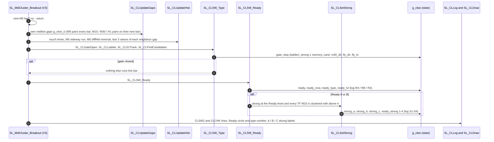

## Gate, ladder and type inputs

The gate decides whether a sideway exists; the ladder and the type inputs are kept from the gate opening (the reset) until it closes.

| Step | Rule | Function |
| --- | --- | --- |
| Gate | opens when the ladder `sw_sl_state ≥ 0` (or a midline cluster with `CLSW_GateCluster`); closes after 2 bars without; opening = the reset, which clears Ready, type, strong, ladder and strong-1 memory | `SL_CLGateOpen`, `SL_CLSW_Clear` |
| Ladder | since the reset each TF goes sideway-ish after the one below: M5 → M15 → M30 → H1; `step` = highest reached (−1 none), several on one bar allowed, never goes down | `SL_CLLadder` |
| Sideway-ish | midtrend sideway (`dmtsw ≥ 3`), weak midtrend 4 / 5, or flat by diffMid (`CLSW_FlatDiffMid`): \|diffMid\| ≤ M5 0.33 / M15 0.6 / M30 0.7 / H1 0.8 / H4 0.9, or ≤ ½ of the bigger of the 2 bars before, or diffMid changed sign | `SL_CLSideIsh`, `SL_CLFlat` |
| Strong-1 memory | since the reset: the M15 band shrank (`m15shr`), then M5–M15 came within 2.25 (`close`) | `SL_CLS1Track` |
| Type inputs | T3: H1 and H4 sideway now, no fly · T1r: M5–M15 ≤ 5 since the reset and M30 trending now (`m30_dir`) · T2: a fly now, H1H4 else M30H1 (`fly_dir`, `fly_lo`) · T1l: M5–M15 touched since the reset and ladder reached M15 · T4: M5 sideway since the reset | `SL_CLFindCandidates` |

The type inputs are recomputed every bar (`CLSW_LatchCand` = false) and only read at a Ready bar to pick one type.

## Ready and type

Ready is checked every gate bar; the first of A, B, T4 that passes sets Ready, type and level, and the latest A or B Ready since the reset decides `ready_type` and `ready_lvl`.

| Ready | Passes when | Level | Type |
| --- | --- | --- | --- |
| A — M5 cluster | M5 event (M5 midtrend sideway, or M5 diffMid just reversed) **and** M5 within CL\_SW of a higher TF: M15 9, M30 3, H1 4, H4 3.1 | highest such TF | type table below |
| B — M15 cluster | no A; M5 **and** M15 midtrend sideway **and** M15 within CL\_SW of a higher TF: M30 5, H1 2, H4 1 | highest such TF | T3 if T3 input, T2 if a fly, else the table |
| T4 — nothing near | no A or B; M5 midtrend sideway 3 bars in a row (`CLSW_T4MinRun`) and every M5 / M15 gap above 2 × its CL\_SW | M5 | T4, only while no A or B Ready since the reset |
| none | near-misses, a short M5 flicker, or no M5 sideway | — | type and level kept |

**Type at Ready A** — first match wins; `dir` = sign of M5 diffMid on the Ready bar.

| Order | Type | When |
| --- | --- | --- |
| 1 | T3 | T3 input |
| 2 | T1 | T1r input and `dir` against M30 |
| 3 | T1 or T2 | T2 input and `dir` with the fly: T1 if M5’s cluster TF is one of the fly’s TFs, else T2 |
| 4 | T1 | T1l input |
| 5 | T2 | T2 input |
| 6 | T1 | T1r input |
| 7 | T4 | nothing above |

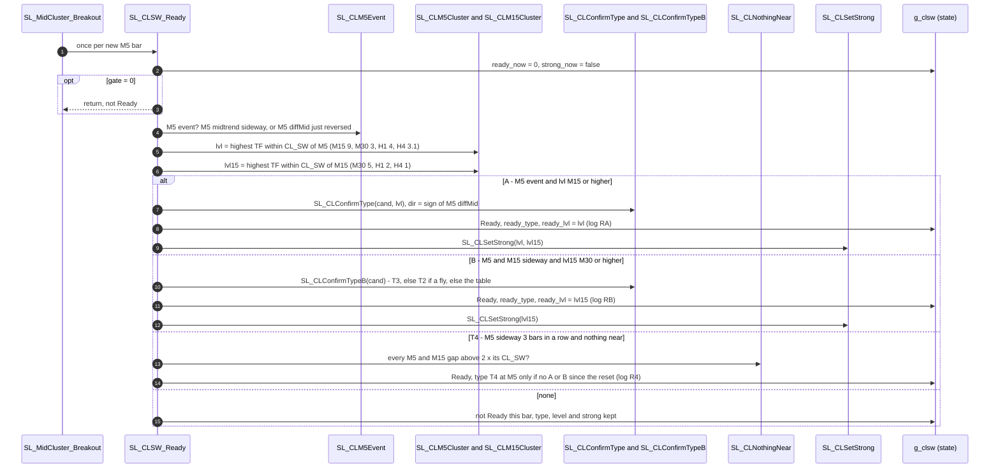

## Strong

Strong grades how tight the squeeze is on a Ready A or B bar; the number is hi, the timeframe being squeezed onto. It never changes Ready, type or level.

**When it is checked**

| # | Action | Debug |
| --- | --- | --- |
| 1 | No Ready A or B on this bar → no strong check (`CLSW_StrongNoReady` = 0) | — |
| 2 | Ready A: check at the Ready level (highest TF M5 is clustered with), plus every TF M15 is clustered with above it | `M15 on M30:` / `M15 on H1:` |
| 3 | Ready B: check at the Ready level (M15’s highest cluster) | — |
| 4 | Level M15 → strong 1, M30 → strong 2, H1 → strong 3, H4 → strong 4 (sections below) | `S1seq` / `S2seq` / `S2:M30` / `S3:H1` |
| 5 | Drop each grade that lacks its need (next table), per level | `NEED:` |
| 6 | Each rule (A, B, C) keeps its highest grade of the bar | — |
| 7 | Keep it until the next reset (last table) | `_S1` … `_S4` |

**What each grade needs on that bar** (`CLSW_StrongNeedM15`)

| Grade | hi | Needs | “Sideway-ish” / “run” |
| --- | --- | --- | --- |
| 1 | M15 | M15 sideway-ish | sideway-ish = midtrend sideway, weak 4 / 5, or flat by diffMid |
| 2 | M30 | M5 run **or** M15 sideway-ish | run = M5 midtrend sideway 2+ bars in a row (`CLSW_S1M5Run`) |
| 3 | H1 | M5 run **or** M15 sideway-ish |  |
| 4 | H4 | M15 sideway-ish |  |

**Keeping the grade**

| # | Action | Input |
| --- | --- | --- |
| 1 | Each rule keeps its own grade: `strong_a`, `strong_b`, `strong_c` (log `A/B/C:x/y/z`) | — |
| 2 | `ready_strong` follows rule C | `CLSW_StrongMode` = 2 |
| 3 | A new strong replaces the kept one: latest wins (0) or only a higher TF wins (1) | `CLSW_StrongKeep` = 0 |
| 4 | Kept until the gate reopens | — |
| 5 | An A / B / C label is drawn when a rule’s kept grade changes | `CLSW_DrawStrongABC` |

## Strong 1 (hi M15)

Strong 1 is a sequence since the gate opened: M15’s band shrinks, M5 comes onto M15, then M5 goes quietly sideway while M30 is still squeezing — and not while M30 is still closing in on M15 (6 Feb 23:15–23:45 → breakout 23:50). All three rules (A, B, C) give the same answer.

| # | Action | Checked | Input | Debug |
| --- | --- | --- | --- | --- |
| 1 | The M15 band shrinks (`BB_diffBBW` < 0) | any bar since the reset, remembered | — | `m15shr:Y` |
| 2 | Then the M5–M15 gap comes within 2.25 | any bar after step 1, remembered | `CLSW_S1Close` | `close:Y` |
| 3 | A Ready A with M5 on M15 (M5–M15 ≤ 9); Ready B and the M15 loop start at M30, so they never give strong 1 | this bar | — | `RA` / `RB` |
| 4 | M5 midtrend sideway 2+ bars in a row | this bar | `CLSW_S1M5Run` | `m5sw:Y(run 2)` |
| 5 | M5 slope quiet: \|M5 diffMid\| ≤ 0.33, or smaller than the bar before | this bar | `CLSW_S1M5Quiet`, `CLSW_S1M5Dmid` | `m5quiet:Y(0.14)` |
| 6 | The M30 band is shrinking | this bar | — | `m30shr:Y` |
| 7 | Wait: M15–M30 closing **and** M30 band shrinking → no strong 1 | this bar | `CLSW_StrongWait1` | `WAIT:M30 still closing in` |
| 8 | Need: M15 sideway-ish | this bar | `CLSW_StrongNeedM15` | `NEED:` |
| 9 | All pass → strong 1 | — | `CLSW_S1Seq` | `-> S1`, `_S1` |

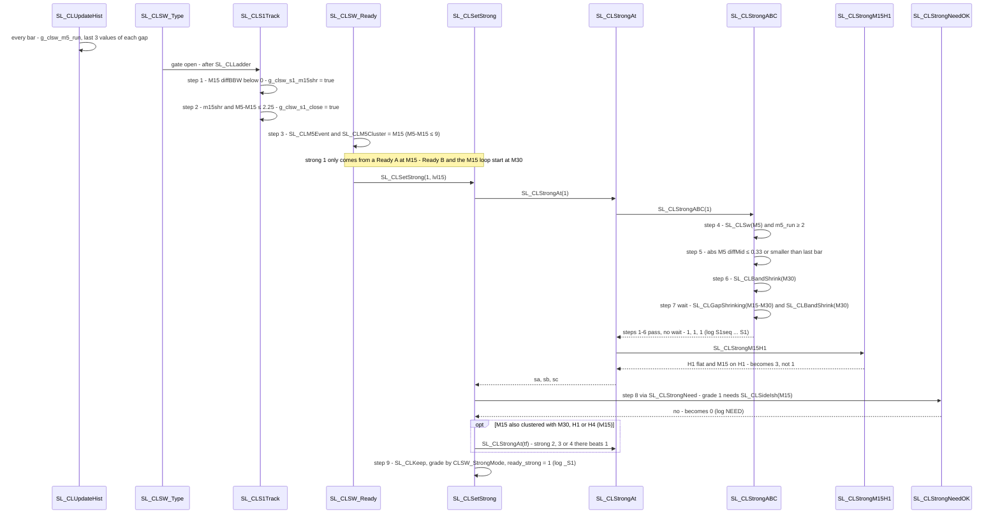

Examples: 6 Feb 23:15 strong 1 (run 2, slope 0.14, M30 −20.7); 24 Feb 11:00–12:25 waits (M15–M30 13.6 → 3.7, M30 −21 → −55); 3 Feb 23:20 no (run 1); 9 Feb 04:30 no (M5 trending).

## Strong 2 (hi M30)

Strong 2 is checked when the Ready is at M30 or M15 sits on M30 (≤ 5), and passes by either route: your sequence (M15 sideway, M5 quietly sideway, M30 squeezing) or rules A / B / C at M30.

**Route 1 — sequence** (`CLSW_S2Seq`)

| # | Action | Debug |
| --- | --- | --- |
| 1 | A Ready at M30, or M15 within 5 of M30 | `RA:…M30` / `M15 on M30:` |
| 2 | M15 sideway-ish | `m15sw:Y` |
| 3 | M5 midtrend sideway 2+ bars in a row with a quiet slope (same test as strong 1, steps 4–5) | `m5quietSw:Y(run 3,0.02)` |
| 4 | The M30 band is shrinking | `m30shr:Y` |
| 5 | All pass → strong 2 for A, B and C | `-> S2` |

**Route 2 — rules A / B / C at M30** (below = M15, step = H1; see Rules A / B / C).

**Then for both routes**

| # | Action | Debug |
| --- | --- | --- |
| 6 | Need: M5 sideway 2+ bars **or** M15 sideway-ish | `NEED:` |
| 7 | Keep the highest grade of the bar per rule | `_S2` |

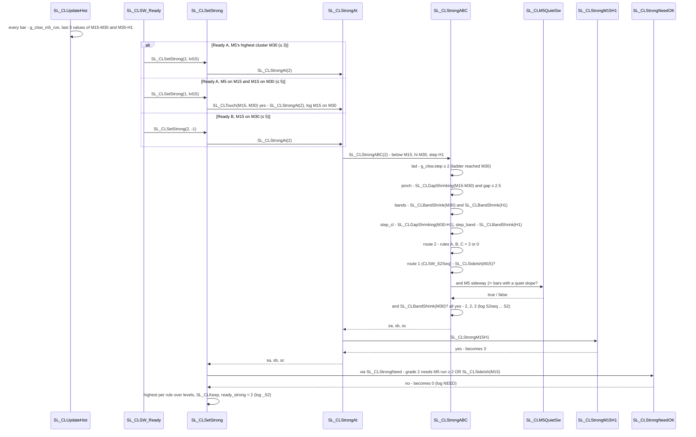

Examples: 11 Feb 11:25–11:40 (route 1: M5 on M30 2.5, run 2–5, M30 shrinking); 13 Feb 11:20 (route 1 via M15 on M30 4.2); 4 Feb 01:10 and 23 Feb 15:15 (route 2); 23 Feb 15:20–15:55 kept by the M5 run while M15 trends up.

## Strong 3 (hi H1)

Strong 3 is checked when the Ready is at H1 or M15 sits on H1 (≤ 2), and passes by rules A / B / C at H1 or by M15 sitting on a flat H1 — the second route runs at every checked level and ignores the ladder.

**Route 1 — rules A / B / C at H1** (below = M30, step = H4; see Rules A / B / C).

**Route 2 — M15 on H1** (`CLSW_StrongM15H1`)

| # | Action | Debug |
| --- | --- | --- |
| 1 | H1 flat by diffMid: \|diffMid\| ≤ 0.8, or ≤ ½ of the bigger of the 2 bars before, or a sign change | `H1flat:Y` |
| 2 | M15 sideway-ish | `M15:Y` |
| 3 | M15–H1 gap between 0 and 1 (½ of CL\_SW 2) | `gap:0.0` |
| 4 | All pass → strong 3 for A, B and C, over any lower grade | `S3m15h1` |

**Then for both routes**

| # | Action | Debug |
| --- | --- | --- |
| 5 | Need: M5 sideway 2+ bars **or** M15 sideway-ish | `NEED:` |
| 6 | Keep the highest grade of the bar per rule | `_S3` |

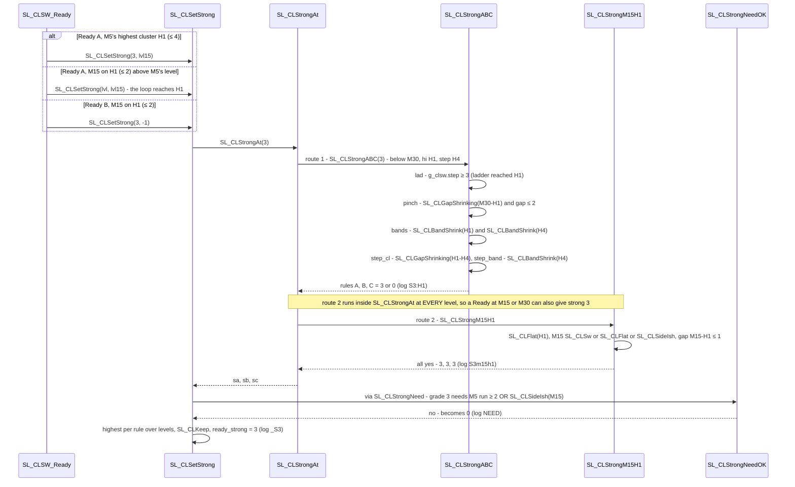

Examples: 2 Feb 23:20 (route 2: H1 diffMid −1.53 after −6.36, M15–H1 0.0, M30 still 29 away); 3 Feb 01:15 keeps it. Strong 3 is the second-noisiest grade (68 % inside your sideways).

## Strong 4 (hi H4)

Strong 4 is a Ready at H4 judged by the squeeze under it: H1–H4 has no CL\_SW, so the H1 checks run and any pass is relabelled 4 (`CLSW_StrongH4Fall`).

| # | Action | Debug |
| --- | --- | --- |
| 1 | A Ready at H4: M5–H4 ≤ 3.1, or M15–H4 ≤ 1 | `_CH4` / `_C15H4` |
| 2 | Run the strong 3 checks at H1 (both routes) | `[hi H4 -> H1 checks]` |
| 3 | Any rule passes → its grade becomes 4 | — |
| 4 | Need: M15 sideway-ish | `NEED:` |
| 5 | Keep it | `_S4` |

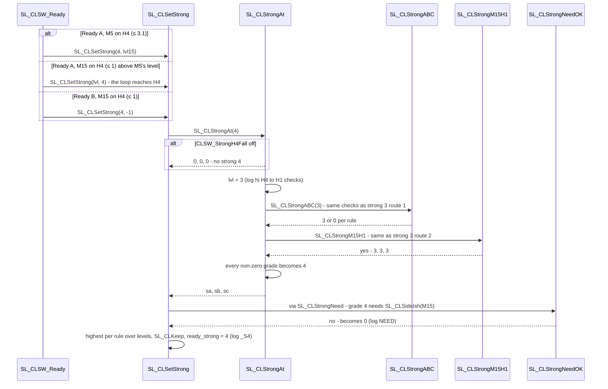

Example: 27 Feb from 13:50 (M5 on H4, M30–H1 1.1 and closing, H1 and H4 bands shrinking, M15 sideway-ish from 13:50) → breakout 14:45. Strong 4 is the weakest grade: 17 bars, mostly 26 Feb, outside your sideways.

## Rules A / B / C and SL\_CLSetStrong

Rules A / B / C are route 2 of strong 2 and route 1 of strong 3 (and so of strong 4). For hi = M30 or H1: below = the TF under hi, step = the TF above.

| # | Check | Debug |
| --- | --- | --- |
| 1 | Ladder reached hi | `lad:Y` |
| 2 | Pinch: gap (below, hi) closing — its last 3 different values each smaller — and ≤ ½ CL\_SW | `pinch:Y` |
| 3 | Bands: the hi band and the step band both shrinking (stage 513 / 523 or diffBBW < 0) | `bands:Y` |
| 4 | Step closing: gap (hi, step) closing | `step<:Y` |
| 5 | Step band: the step band shrinking | `stepBand:Y` |
| → | **A** = 1 + 2 + 3 · **B** = A, or 1 + 4 · **C** = A, or 1 + 4 + 5 | `-> A? B? C?` |

`SL_CLSetStrong` puts the levels, the needs and the keeping together:

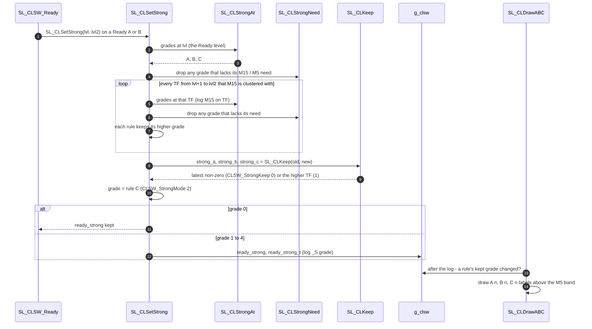

## Strong call chain

How the strong functions call each other on one M5 bar. The first diagram is the whole chain; the next six open one function each. A solid arrow is a call or a check, a dashed arrow is what comes back.

| Function | Called by | Calls | Returns |
| --- | --- | --- | --- |
| SL\_CLSetStrong | SL\_CLSW\_Ready (Ready A / B) | SL\_CLStrongAt, SL\_CLStrongNeed, SL\_CLTouch, SL\_CLKeep | nothing; writes strong\_a / b / c, ready\_strong, g\_clsw\_strong\_now |
| SL\_CLStrongAt | SL\_CLSetStrong | SL\_CLStrongABC, SL\_CLStrongM15H1 | sa, sb, sc at one level (H4 → H1 checks, relabelled 4) |
| SL\_CLStrongABC | SL\_CLStrongAt | SL\_CLGapShrinking, SL\_CLBandShrink, SL\_CLSw, SL\_CLSideIsh, SL\_CLM5QuietSw | sa, sb, sc = 0 or the grade (S1 sequence, rules A / B / C, S2 sequence) |
| SL\_CLStrongM15H1 | SL\_CLStrongAt (every level) | SL\_CLFlat, SL\_CLSw, SL\_CLSideIsh | true → all three rules = 3 |
| SL\_CLStrongNeed / SL\_CLStrongNeedOK | SL\_CLSetStrong (per level) | SL\_CLSideIsh (→ SL\_CLFlat, SL\_CLSw), SL\_CLSw | grades that lack their need set to 0 |
| SL\_CLM5QuietSw | SL\_CLStrongABC (strong 2 sequence) | SL\_CLSw; reads g\_clsw\_m5\_run from SL\_CLUpdateHist | true when M5 is sideway 2+ bars with a quiet slope, plus d0 |

### Whole chain

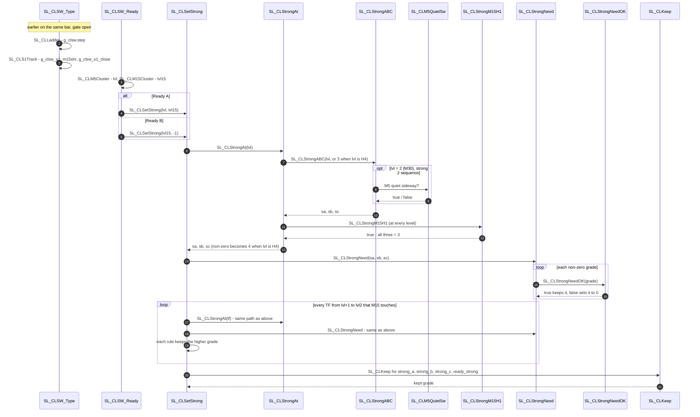

### SL\_CLSetStrong

The top of the chain. It grades the Ready level, then every higher TF that M15 is clustered with, keeps the highest grade per rule, and writes the kept grades.

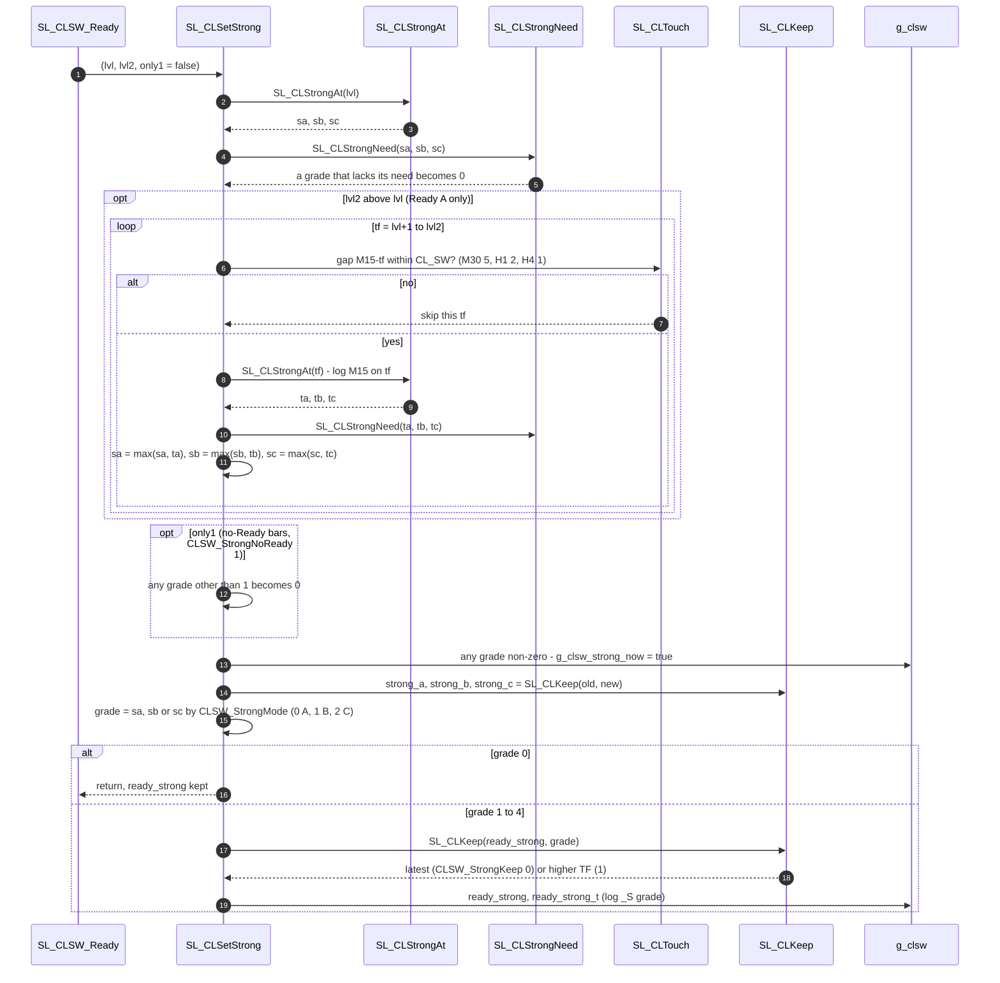

### SL\_CLStrongAt

Grades one level. H4 has no level above it to squeeze into, so it borrows the H1 checks and relabels the result 4. The M15-on-H1 route runs after rules A / B / C at every level, and wins.

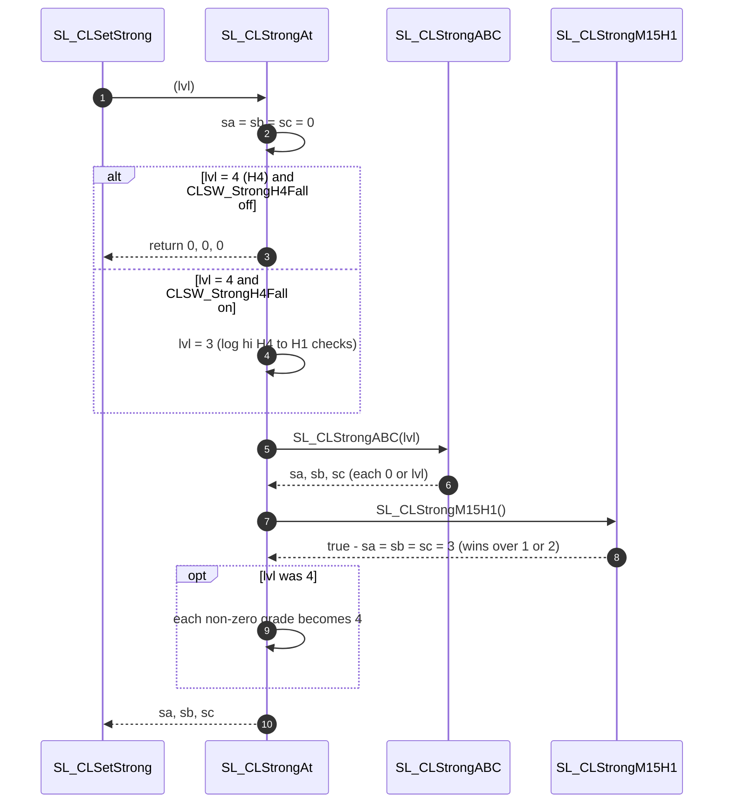

### SL\_CLStrongABC

Works out the shared parts (lad, pinch, bands, step\_cl, step\_band, wait), then takes one of two paths: the strong 1 sequence at M15, or rules A / B / C at M30 and H1 with the strong 2 sequence added at M30. The strong 1 path checks M5's quiet slope inline; it does not call SL\_CLM5QuietSw.

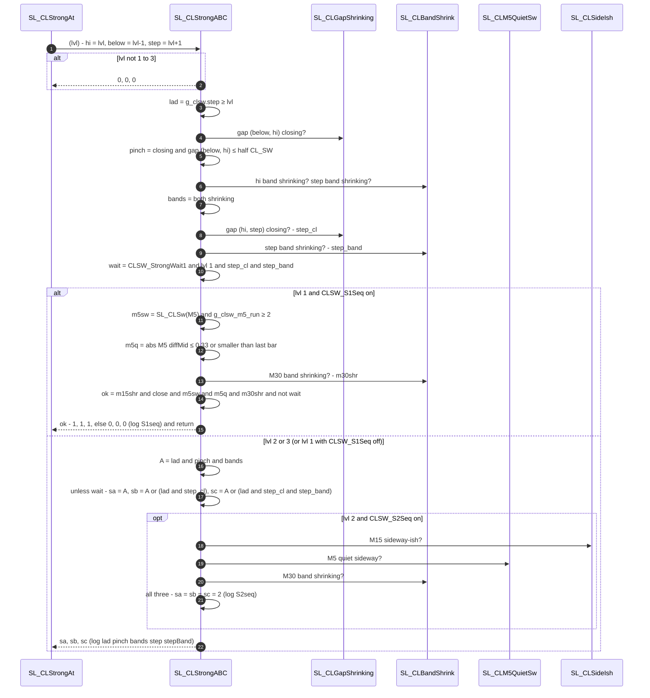

### SL\_CLStrongM15H1

Strong 3 through M15: H1 has gone flat and M15 sits on the H1 midline, even while M30 is still trending away.

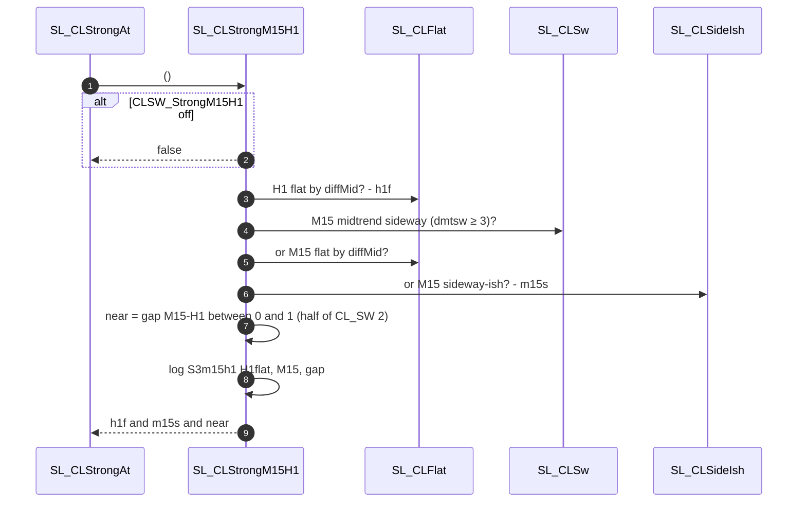

### SL\_CLStrongNeed and SL\_CLStrongNeedOK

The per-grade need, applied to each level before the levels are combined. SL\_CLStrongNeed loops over the three rules; SL\_CLStrongNeedOK answers for one grade.

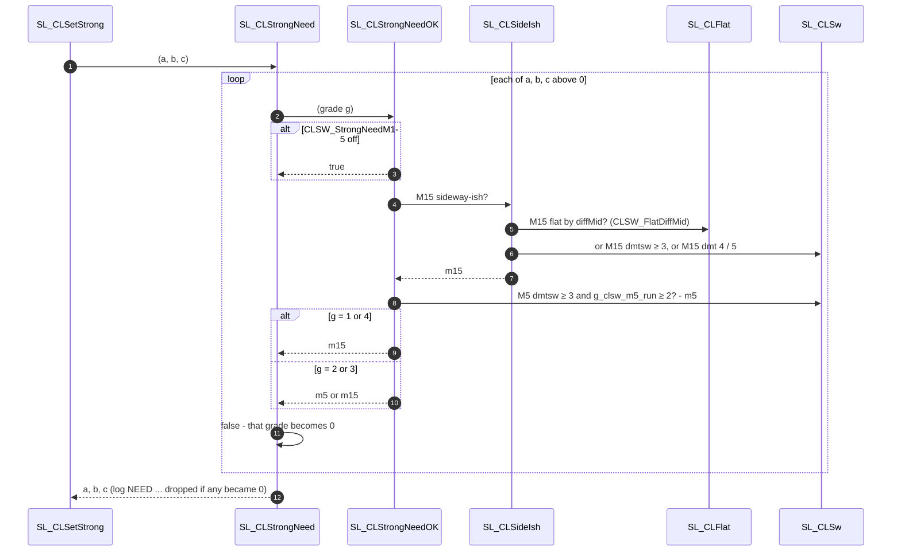

### SL\_CLM5QuietSw

M5 sideway for 2+ bars in a row with its slope going quiet. Only the strong 2 sequence calls it; the strong 1 path runs the same test inline.

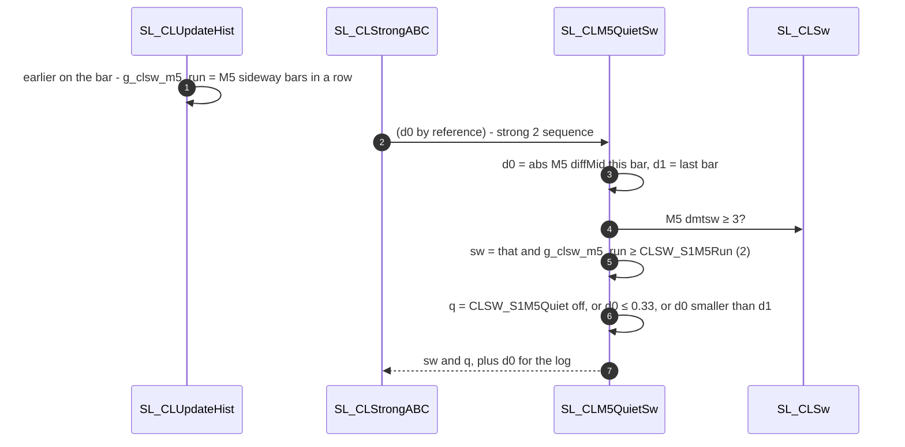

## February replay

With all V3 defaults (rule C), strong fires on 290 Ready bars, 84 % of them inside your sideways, with a strong in the 6 h before 24 of your 37 breakouts; strong 2 carries most of it and strong 4 is mostly noise.

| Strong | Bars | Inside your sideways | Your breakouts within 6 h after |
| --- | --- | --- | --- |
| 1 (M15) | 64 | 95 % | 12 |
| 2 (M30) | 137 | 96 % | 15 |
| 3 (H1) | 72 | 68 % | 5 |
| 4 (H4) | 17 | 12 % | 1 |
| all | 290 | 84 % | 24 / 37 (11 strong episodes outside your sideways) |

**Your dates** (strong kept on that bar, rule C, keep latest):

| Time | Strong | Why |
| --- | --- | --- |
| 02.02 23:20 → 23:55 | 3 | M15 on a flat H1 |
| 02.03 01:15 breakout | 3 | kept from 02.02 |
| 02.04 01:10 → 01:50 | 2 | Ready B at M30, rules A / B / C |
| 02.06 23:15 → 23:45 | 1 | strong 1 sequence |
| 02.09 15:30 → 16:25 | 2 | rules B / C (M30–H1 closing) |
| 02.11 11:25 → 11:40 | 2 | strong 2 sequence |
| 02.13 11:20 → 14:15 | 2 | strong 2 sequence via M15 on M30 |
| 02.23 15:15 → 16:25 | 2 | M15 on M30, kept through 15:20–15:55 by the M5 run |
| 02.24 11:00 → 12:25 | none | strong 1 waits for M30 |
| 02.24 13:15 → 13:55 | 2 | M30 shrink nearly done, M15–M30 0.3–0.8 |
| 02.27 13:50 → 14:40 | 4 | Ready at H4, H1 checks pass |

Known leftovers: 26 Feb 07:05 comes back as strong 3 (M5 sideway, outside your sideways); 26 Feb 14:35–16:05 strong 4 (outside). Replay limits: values come from your log lines (completed bars for M15 and above), so the EA can move by a bar.

## Code map

`SL_MidCluster_Breakout_V3.mqh` has the same entry call as V1 / V2 (`SL_CLSW_Reset()` in OnInit, `SL_MidCluster_Breakout(BB_datas, g_tradectx)` on tick); include only one of V1, V2, V3.

| Function | Does |
| --- | --- |
| `SL_CLUpdateGaps`, `SL_CLGapSet` | own midline gaps `g_clsw_cl` |
| `SL_CLUpdateHist` | touch times, M5 run, M5 reversal, gap history (`g_clsw_gh`, `g_clsw_ghn`) |
| `SL_CLSW_Type`, `SL_CLGateOpen`, `SL_CLSW_Clear` | gate and reset |
| `SL_CLLadder`, `SL_CLSideIsh`, `SL_CLFlat` | ladder and sideway-ish |
| `SL_CLS1Track` | strong-1 memory (M15 shrank, then M5–M15 close) |
| `SL_CLFindCandidates` | type inputs |
| `SL_CLSW_Ready`, `SL_CLM5Event`, `SL_CLM5Cluster`, `SL_CLM15Cluster`, `SL_CLNothingNear` | Ready A / B / T4 |
| `SL_CLConfirmType`, `SL_CLConfirmTypeB` | type at Ready |
| `SL_CLSetStrong`, `SL_CLStrongAt`, `SL_CLStrongABC`, `SL_CLStrongM15H1` | strong grades |
| `SL_CLM5QuietSw`, `SL_CLGapShrinking`, `SL_CLBandShrink` | M5 run + quiet slope, gap closing, band shrinking |
| `SL_CLStrongNeed`, `SL_CLStrongNeedOK`, `SL_CLKeep` | per-grade need, keeping |
| `SL_CLLog`, `SL_CLDebugMem`, `SL_CLDraw`, `SL_CLDrawABC` | logs and chart marks |

**Inputs**

| Input | Default | Meaning |
| --- | --- | --- |
| `CLSW_GateCluster` | false | also open the gate on midline clusters |
| `CLSW_LatchCand` | false | type inputs recomputed every bar |
| `CLSW_T4MinRun` | 3 | Ready T4: M5 sideway bars in a row |
| `CLSW_StrongMode` | 2 | rule behind `ready_strong`: 0 A, 1 B, 2 C |
| `CLSW_StrongKeep` | 0 | 0 latest strong, 1 highest TF |
| `CLSW_FlatDiffMid` | true | flat diffMid counts as sideway-ish |
| `CLSW_StrongWait1` | true | strong 1 waits while M30 closes in and shrinks |
| `CLSW_S1Seq` | true | strong 1 = the sequence |
| `CLSW_S1Close` | 2.25 | strong 1 “very close” M5–M15 |
| `CLSW_S1M5Run` | 2 | M5 sideway bars in a row (strong 1, strong 2 sequence, need) |
| `CLSW_S1M5Quiet`, `CLSW_S1M5Dmid` | true, 0.33 | M5 slope quiet |
| `CLSW_S2Seq` | true | strong 2 also by the sequence |
| `CLSW_StrongM15H1` | true | strong 3 route 2 |
| `CLSW_StrongH4Fall` | true | strong 4 |
| `CLSW_StrongNeedM15` | true | per-grade need |
| `CLSW_StrongNoReady` | 0 | strong without a Ready: 0 off, 1 strong 1 only, 2 any |
| `CLSW_Log`, `CLSW_DrawReady`, `CLSW_DrawStrongABC` | true | logs and drawing |
| `CLSW_DebugMem`, `CLSW_DebugFrom`, `CLSW_DebugTo` | false, all time | `[CLMEM]` window |

**Outputs in `g_clsw`:** `gate`, `step` (ladder −1–3), `cand`, `ready` (Ready since the reset), `ready_now` (this bar), `ready_type` 1–4, `ready_lvl` 0–4, `ready_t`, `ready_strong` 0–4, `ready_strong_t`, `strong_a / strong_b / strong_c`.

## Logs and debugging

One `[CLSW2]` line per M5 bar carries every decision; `evt{}` has three parts: gate + type inputs | Ready | strong checks.

| Field | Meaning |
| --- | --- |
| `gate`, `cand`, `step` | gate (0 / 1 / 2), type inputs, ladder step |
| `rdy`, `now`, `type`, `lvl` | Ready since the reset, Ready this bar, kept type and level |
| `strong`, `A/B/C` | `ready_strong`, and each rule’s kept grade (since the reset, not this bar) |
| `ladder`, `m5run` | ladder TF, M5 sideway run |
| `evt{…\|…\|…}` | part 2: `m5sw` / `m5rev`, `_C<TF>`, `_C15<TF>`, `_RA:T<n><TF>`, `_RB:…`, `_R4`, `_S<n>`; part 3: the strong check lines below |

| Strong debug | Meaning |
| --- | --- |
| `S1seq m15shr:Y close:Y m5sw:Y(run 2) m5quiet:Y(0.14) m30shr:Y -> S1` | strong 1 sequence; `WAIT:M30 still closing in` when blocked |
| `S2seq m15sw:Y m5quietSw:Y(run 3,0.02) m30shr:Y -> S2` | strong 2 sequence |
| `S2:M30 lad:Y pinch:N bands:N step<:Y stepBand:N -> A0 B2 C0` | rules A / B / C at that level, **this bar only** |
| `S3m15h1 H1flat:Y M15:Y gap:0.0` | strong 3 route 2 |
| `[hi H4 -> H1 checks]` | strong 4 |
| `\| M15 on M30:` | the extra level from M15’s clusters |
| `NEED:M15 not sideway-ish M5run 1 -> dropped` | per-grade need removed a grade |

| Line | When | Shows |
| --- | --- | --- |
| `[CLCHK]` | every bar (temporary) | own gaps next to `ctx.cl` H4 slots |
| `[CLMEM]` | `CLSW_DebugMem` + window | reset, M5 run, ladder, `gaps m15m30[3]:6.8>10.3>10.5 close:Y` (`[n]` = values stored), touch times |

## Open items

- [ ] `CLSW_StrongKeep`: keep the latest strong (0) or the highest TF (1) — decides which grade shows when several fire in one sideway (e.g. 27 Feb: strong 2 earlier, strong 4 at 13:50).
- [ ] Strong 3 need: “M5 run or M15” (5 breakouts, brings back 26 Feb 07:05) or “M15 only” (74 % inside, 3 breakouts).
- [ ] Strong 4 stays weak (12 % inside): add a condition such as the H4 band shrinking for N bars, or keep as information.
- [ ] Replace the word “candidate”: fold the type inputs into the type decision at the Ready bar (same results, `why:` tag).
- [ ] `SL_init` copies the midline pairs into `ctx.cl` without the H4 slots; V3 works around it with its own gaps.
- [ ] Breakout stages (trigger, price confirm, end) are not in V3 yet.
- [ ] Fitted on February only: replay a month you label blind before trusting the numbers.
