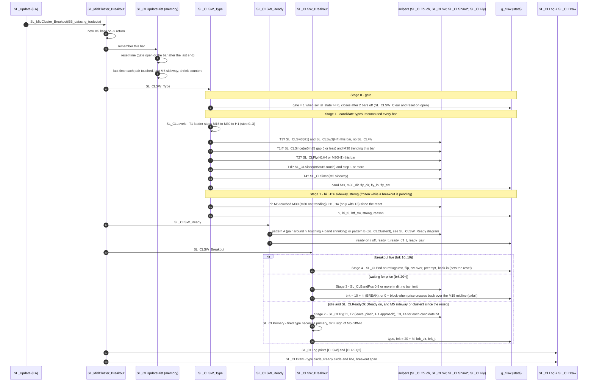
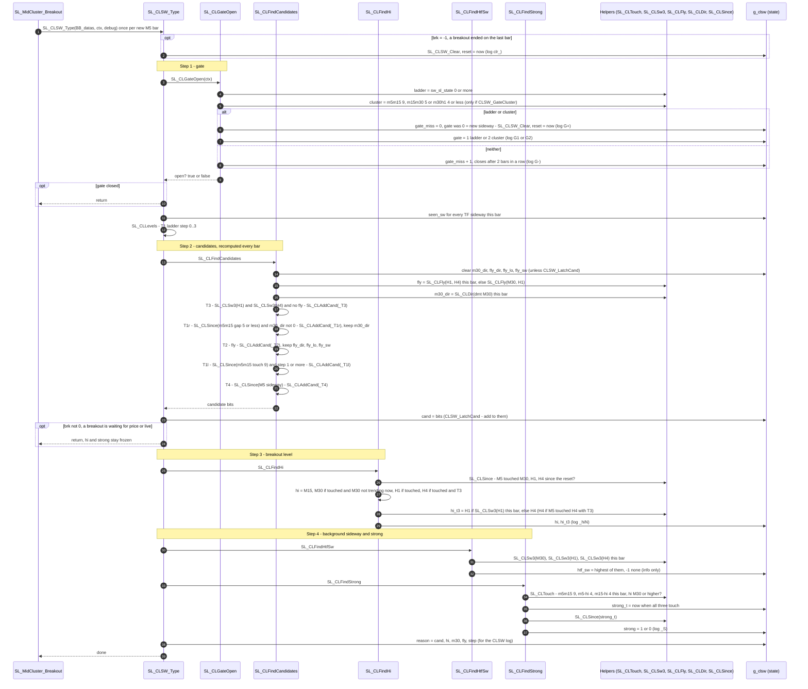
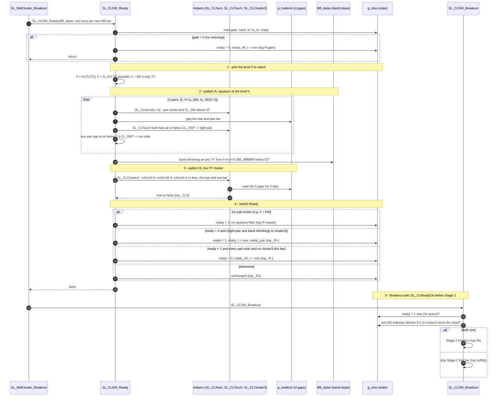

# CLSW Breakout — Requirements & Architecture

Oct 31, 2026 · @terry pang

## Breakout table — February (V38.35.16\_2)

Your 37 breakout times against the Stage 1 replay rebuilt from this doc’s rules: ✓ = matches your label, (yours X) = differs, no mark = not labelled by you yet. Candidates = the `clcand` bits set at the breakout (T1r = T1 reversal, T1l = T1 levels); Strong = `clstrong`.

| Breakout | Your types | Primary | Candidates | hi | Sideway TF | T1 pair (hi−1, hi) · hi shrink done | HTF sideway | Strong | Dir | Check |
| --- | --- | --- | --- | --- | --- | --- | --- | --- | --- | --- |
| 02.03 01:15 | T1 | T1 (reversal) | T1r T1l T4 | H1 ✓ | — uses hi (yours M30) | M30–H1 22.5 (≤4 ✗) · H1 shrink done – | – | 1 | UP | ok |
| 02.04 02:10 | T2 | T2 | T2 T4 | M15 | M15 (clfly\_sw) | – | – | – | UP | ok |
| 02.04 11:05 | T1 | T1 (reversal) | T1r T1l T4 | M15 ✓ | — uses hi | M5–M15 2.8 (≤9 ✓) · M15 shrink done 10:30 | – | – | DN | ok |
| 02.04 16:15 | T1 | T1 (levels) | T1l T4 | M15 ✓ | — uses hi | M5–M15 0.2 (≤9 ✓) · M15 shrink done – | – | – | DN | ok |
| 02.05 10:30 | T2 + T4 | T4 | T4 | M5 | M5 | – | – | – | DN | ok |
| 02.05 20:30 | T2 + T4 | T2 | T2 T4 | M15 | M5 (clfly\_sw) | – | – | – | DN | ok |
| 02.06 07:00 | T4 | T4 | T4 | M5 | M5 | – | – | – | UP | ok |
| 02.06 12:15 | T4 | T4 | T4 | M5 | M5 | – | H1 | – | UP | ok |
| 02.06 23:50 | T2 | T2 | T2 T1l T4 | M15 | M5 (clfly\_sw) | – | – | – | UP | ok |
| 02.09 16:25 | T1 + T2 | T1 (levels) | T1l T4 | M30 ✓ | — uses hi | M15–M30 4.3 (≤5 ✓) · M30 shrink done 15:00 | H4 | – | UP | ok |
| 02.10 10:30 | T1 | T1 (reversal) | T1r T2 T1l T4 | M30 ✓ | — uses hi (yours M15) | M15–M30 0.8 (≤5 ✓) · M30 shrink done – | – | 1 | UP | ok |
| 02.11 01:00 | T1 + T2 + T4 | T1 (reversal) | T1r T1l T4 | M15 ✓ | — uses hi | M5–M15 3.8 (≤9 ✓) · M15 shrink done 01:00 | H1 | – | UP | ok |
| 02.11 11:45 | T2 + T3 | T2 | T2 T1l T4 | M15 | M30 (clfly\_sw) | – | – | – | UP | ok |
| 02.12 01:00 | T1 + T2 | T1 (reversal) | T1r T2 T1l T4 | M15 ✓ | — uses hi | M5–M15 0.1 (≤9 ✓) · M15 shrink done 01:15 | – | – | UP | ok |
| 02.13 02:45 | T1 + T4 | T1 (reversal) | T1r T1l T4 | M15 | — uses hi | M5–M15 0.9 (≤9 ✓) · M15 shrink done 02:30 | – | – | UP | ok |
| 02.13 15:30 | T1 | T1 (reversal) | T1r T1l T4 | H1 ✓ | — uses hi | M30–H1 11.9 (≤4 ✗) · H1 shrink done – | – | – (yours 1) | UP | strong ✗: your left circle is 12:55, outside the 90-min window |
| 02.16 01:05 | T1 + T4 | T1 (reversal) | T1r T1l T4 | M15 ✓ | — uses hi | M5–M15 1.7 (≤9 ✓) · M15 shrink done – | H4 | – | DN | ok |
| 02.16 04:30 | T1 + T4 | T1 (reversal) | T1r T1l T4 | M30 ✓ | — uses hi (yours M5) | M15–M30 0.5 (≤5 ✓) · M30 shrink done – | H4 | 1 | DN | M5 also touches H4 03:50–04:30, but no T3 → hi M30 ✓ (your rule) |
| 02.16 15:00 | T1 + T4 | T1 (levels) | T1l T4 | H1 | — uses hi | M30–H1 11.7 (≤4 ✗) · H1 shrink done 15:00 | H1 | – | DN | ok |
| 02.17 01:00 | T2 + T3 + T4 | T1 (levels) | T1l T4 | H1 | — uses hi | M30–H1 1.9 (≤4 ✓) · H1 shrink done – | – | – | UP | ✗ log T1: m5m15 5.6 passes the levels touch (≤ 9); fly H1H4 is DN, breakout UP |
| 02.17 06:30 | T2 | T2 | T2 T1l T4 | M15 | M30 (clfly\_sw) | – | – | – | DN | ok |
| 02.17 15:45 | T2 + T4 | T2 | T2 T1l T4 | M30 | M15 (clfly\_sw) | – | – | 1 | DN | ok |
| 02.18 03:00 | T1 + T2 + T4 | T1 (levels) | T1l T4 | M30 ✓ | — uses hi | M15–M30 0.9 (≤5 ✓) · M30 shrink done – | – | 1 | UP | ok |
| 02.18 10:00 | T1 | T1 (reversal) | T1r T4 | M15 | — uses hi (yours M5) | M5–M15 2.8 (≤9 ✓) · M15 shrink done – | H4 | – | DN | ok |
| 02.18 14:30 | T2 + T4 | T2 | T2 T1l T4 | M15 | M15 (clfly\_sw) | – | H4 | – | UP | ok |
| 02.18 20:00 | T2 + T4 | T4 | T4 | M5 | M5 | – | H4 | – | DN | ok |
| 02.19 06:30 | T1 + T4 | T1 (reversal) | T1r T1l T4 | M15 ✓ | — uses hi | M5–M15 0.1 (≤9 ✓) · M15 shrink done 06:00 | – | – | UP | ok |
| 02.19 16:45 | T1 + T4 | T1 (levels) | T1l T4 | H1 ✓ | — uses hi | M30–H1 7.5 (≤4 ✗) · H1 shrink done 17:00 | H4 | 1 ✓ | UP | ok |
| 02.20 06:25 | T3 | T3 | T3 T1l T4 | H1 ✓ | H1 (= hi) | – | H4 | 1 | ? | ok |
| 02.20 07:00 | T1 + T3 | T3 | T3 T1l T4 | H1 ✓ | H1 (= hi) | – | H4 | 1 | UP | ok |
| 02.20 15:30 | T2 + T4 | T2 | T2 T1l T4 | M15 | M5 (clfly\_sw) | – | – | – | UP | ok |
| 02.23 16:30 | T2 + T4 | T2 | T2 T1l T4 | M30 | M30 (clfly\_sw) | – | M30 | 1 | UP | ok |
| 02.24 14:00 | T1 + T2 | T1 (levels) | T1l T4 | M30 ✓ | — uses hi | M15–M30 0.2 (≤5 ✓) · M30 shrink done 14:00 | H1 | 1 | DN | ok |
| 02.25 03:00 | T1 | T1 (levels) | T1l | M30 ✓ | — uses hi | M15–M30 1.4 (≤5 ✓) · M30 shrink done 01:30 | – | – | UP | ok |
| 02.25 12:00 | T1 | T1 (reversal) | T1r T1l T4 | M15 ✓ | — uses hi | M5–M15 0.8 (≤9 ✓) · M15 shrink done 12:15 | – | – | DN | ok |
| 02.25 18:00 | T1 + T2 | T2 | T2 T1l T4 | M30 | M30 (clfly\_sw) | – | M30 | 1 | UP | ok |
| 02.27 14:45 | T1 + T3 | T1 (levels) | T1l T4 | H1 (yours H4) | — uses hi | M30–H1 0.1 (≤4 ✓) · H1 shrink done 15:00 | H4 | 1 | UP | hi stays H1: H4 counts only with the T3 bit (your rule), and T3 does not fire here (H1 sideway 12 % of last 2 h) — D11 |

Score with the old clock windows: type 36 / 37 · hi 19 / 19 labelled (no clocks, 31 Oct: 35 / 37 · 15 / 19) · sideway TF not scored (T1 uses hi). The same rules with “since the gate opened” instead of clock windows score 32 / 37 · 14 / 19, so the windows stay.

T1 pair = the smallest gap between hi − 1 and hi in the 60 min before the breakout, against that pair’s CL\_SW. hi shrink done = the last time hi’s band went from ≥ 2 shrinking bars to widening, from 90 min before to 15 min after the breakout. “–” means the log cannot show it: band widths are only printed on ladder-sideway bars and only for completed bars, so most “shrink done” times need the \[CLREQ2\] `dbbw` values. On 4 of the 6 hi-H1 T1 rows, M30–H1 is not close (02.03 01:15, 02.13 15:30, 02.16 15:00, 02.19 16:45): there hi H1 comes from M5 touching H1 directly, not from M30 sitting on H1.

The midline-cluster breakout is split into five stages; Stage 1 (sideway type and hi) reproduces your February labels, and Stage 2 (when each type breaks out) is a draft still to be replayed.

## Status

All five stages are now specified and replayed together on February: 20 of your 37 breakouts found, 86 breakouts in total, price move summed +193.6. No rule uses a clock or a time window (decided 31 Oct).

| Part | February score (V38.35.16\_2) | State |
| --- | --- | --- |
| Sideway type (T1–T4) | 35 / 37 with no clocks (36 / 37 with the old clock windows) | specified |
| hi (breakout level) | 15 / 19 with no clocks (19 / 19 with clocks); the full replay still finds more breakouts, so the loss is accepted | specified |
| Sideway TF (T2 only) | T1 uses hi: same trigger on all 21 T1 rows | S dropped for T1 until \[CLREQ2\] (D9) |
| SL\_CLSW\_Ready (compression) | patterns A + B, no grace, see Stage 1b | specified |
| clstrong (strong cluster flag) | now “since the reset” instead of 90 min; not re-measured | needs your strong labels |
| Stage 2 triggers + primary | 3 ways to fire T2; the fired type becomes primary; direction from M5 diffMid | replayed |
| Stage 3 price confirm | no bar limit; cancelled when price crosses back over the M15 midline | replayed |
| Stage 4 end | E5 “M5 against” | replayed |
| **Whole pipeline** | **20 / 37 found · 86 breakouts · 42 inside / 24 outside your sideways · +193.6 · 44 % positive** | **replayed, not validated** |

How each decision moved the February replay, applied in this order (end rule E5 in every row):

| Decision | Breakouts | Your 37 found | False inside / outside your sideways | Price move summed |
| --- | --- | --- | --- | --- |
| Ready A or B, dir0 check removed | 46 | 13 | 19 / 14 | +167.9 |
| + midline-pinch T2 trigger | 46 | 13 | 19 / 14 | +177.7 |
| + fired type becomes primary | 64 | 18 | 31 / 15 | +186.3 |
| + live M5 direction from diffMid | 63 | 18 | 30 / 15 | +204.8 |
| + H1-approach T2 trigger | 64 | 18 | 31 / 15 | +214.5 |
| **+ no clocks, price check cancelled at the M15 midline** | **86** | **20** | **42 / 24** | **+193.6** |

The last row trades 21 points and about 20 more false breakouts a month for 2 more of your breakouts and no time rules. Fallback if that is too noisy: keep a 3-bar limit on the price check only (69 breakouts, 19 found, 29 / 21, +204.0).

- **Fitted, not validated.** Labels and rules were adjusted together on the same month (e.g. 02.13 02:45 went T1 → T4 → T1 + T4; 02.19 16:45 hi 1 → 3). The real accuracy is unknown until a month labelled blind is replayed.
- **Replay approximations:** `dmtsw` rebuilt exactly from `dmt`; band widths from completed bars only (no forming bar); no M5 or H4 band in the log; band widths only on ladder-sideway bars.
- **Known sensor gap:** you read “midtrend sideway” from a flat midline; `dmt == 3` misses slow-but-flat midlines (02.03 H1, 02.10 M30). The `[CLREQ2]` log line is needed to replace it.

## Scope

CLSW owns breakouts out of a midline-cluster sideway; a pure M5 trend reversal with no M5 cluster belongs to `SL_TrendReversal`.

| Case | Owner | February examples |
| --- | --- | --- |
| Breakout from a cluster sideway (T1–T4) | `SL_CLSW_Type` + `SL_CLSW_Ready` + `SL_CLSW_Breakout` | 37 times |
| M5 trend reversal, no M5 pair within `CL_SW` in the last 30 min | `SL_TrendReversal` | 02.09 23:05, 02.10 17:00, 02.19 18:30 |
| Breakout seen from close price only, no type | none yet | 02.12 18:05 |

When both functions fire on the same event, only one signal may reach `Trade_act` (open decision D6).

## Shared definitions

Every rule below is written with these building blocks; timeframe index = `BB_datas` index (0 M5, 1 M15, 2 M30, 3 H1, 4 H4).

| Name | Definition |
| --- | --- |
| `cls(v)` | `dmt` 1 or 5 → +1 (up); 2 or 4 → −1 (down); 3 or 0 → 0 |
| `gap(a,b)` | `ctx.cl[a][b][0]`, always read with a < b |
| `touch(a,b)` | `0 ≤ gap(a,b) ≤ CL_SW[a][b]` (negative = unloaded, never a touch) |
| `CL_SW` | m5m15 9 · m5m30 3 · m5h1 4 · m5h4 3.1 · m15m30 5 · m15h1 2 · m15h4 1 · m30h1 4 · m30h4 0 (off) · h1h4 0 (off) |
| `sw(tf)` | `dmtsw[tf][0] ≥ 3` (to be replaced by a flat-midline test after `[CLREQ2]`) |
| `trending(tf)` | `cls(dmt[tf])` is +1 or −1 on this bar |
| `fly(a,b)` | `cls(dmt[a]) == cls(dmt[b]) != 0` |
| `opens(tf, 30m)` | `scoring only, not a rule: tf band widens ≥ +4 within 30 min after the breakout` |
| `dir` | majority `cls(dmt[M5])` over the 30 min after the breakout bar; live: `sign of M5 BB_diffMid on the trigger` bar |
| M5 short sideway | a run of bars with `dmtsw[0] ≥ 3` seen since the reset |

## Stage 0 — Context gate (start of SL\_CLSW\_Type)

The gate opens when the ladder or the clusters say a sideway exists, and everything after it runs only while it is open.

| # | Rule | Status |
| --- | --- | --- |
| G1 | `sw_sl_state[0] ≥ 0` → `clgate = 1` (ladder) | measured |
| G2 | or any top pair touches: m5m15, m15m30, m30h1 (h1h4 once `CL_SW` > 0) → `clgate = 2` (cluster only) | D1 — 4 boxes had the ladder on < 50 % of the time and were all missed |
| G3 | closes only after 2 consecutive bars with neither G1 nor G2 → Stage 4 | one bar of slack |

On open, record `clgate_t`. **No rule in this doc uses a clock.** Every rule reads one of two things:

- **a state** — this bar only (e.g. “H1 and H4 sideway now”);
- **evidence since the reset** — anything seen since `clreset_t`, the bar the gate opened or the bar after the last breakout ended (e.g. “M5 touched H1 since the reset”).

G3’s 2-bar close is a filter against one-bar flickers, not an expiry.

## Stage 1 — SL\_CLSW\_Type: type detection

`SL_CLSW_Type` stores candidate types, not a primary type. Each bar Type sets candidate bits in `clcand`; when a Stage 2 trigger fires, **the fired type becomes the primary** (the highest in the order below if several fire on one bar) and Breakout writes `cltype`. `dir` = the sign of M5 diffMid on the trigger bar (M5 dmt lags).

| Order | Candidate (bit) | Type sets the bit when | A fired trigger counts when |
| --- | --- | --- | --- |
| 1 | T3 HTF long sideway | H1 and H4 dmt == 3 on this bar, and no fly on this bar | always (02.20 06:25) |
| 2 | T1 reversal | M5–M15 gap ≤ 5 at least once since the reset, and M30 trending one way on this bar; stores `clm30_dir` | dir == −`clm30_dir` (02.03 01:15, 02.10 10:30) |
| 3 | T2 fly midway | fly on this bar: H1 and H4 trending the same way, else M30 and H1; stores `clfly_dir` and the fly’s lower TF | dir == `clfly_dir` |
| 4 | T1 levels | M5–M15 touch (≤ CL\_SW 9) at least once since the reset, and ≥ 1 level completed since the gate opened | always (02.16 15:00, 02.24 14:00) |
| 5 | T4 M5 short sideway | M5 sideway at least once since the reset | always (02.06 07:00) |

T1 is one type with two entry rules; both feed the same Stage 2 trigger, and order 2 sits above T2 only so a fly in the breakout direction cannot take a reversal. The old 6th row (T3 fallback) is removed: it sat after “none of the above” and could never run.

**No clocks.** “This bar” replaces the old 1 h and 2 h shares; “since the reset” replaces the 30 and 60 min windows. Stage 1 alone drops from 36 to 35 / 37 (02.17 01:00 and 02.27 14:45 miss: H1 and H4 switch between sideway and fly from bar to bar), but the whole pipeline finds 20 / 37 instead of 18 (Status).

Known miss: 02.17 01:00 (yours T2 + T3 + T4) comes out T1 levels — m5m15 is 5.6, inside the ≤ 9 touch, and the H1H4 fly is DN against an UP breakout, so neither T2 nor T3 can claim it. A 6 h freshness limit on the levels fixes it but breaks 02.19 16:45 and 02.27 14:45, so it is left open.

**Latch.** Candidate bits are set when their rule first passes and stay set for the context:

- Bits only add; `cltype` is written once, by Breakout, when a trigger fires.
- After a breakout fires, `cltype` is frozen — except a higher-order candidate appearing later, which ends the live breakout first (Stage 4, E3).
- All bits, `clm30_dir`, `clfly_dir`, `clfly_lo` and `clfly_sw` clear when the gate closes or after a breakout ends.

**T4 as an overlay is not specified.** On 15 of your rows T4 is ticked beside T1 or T2, but no tested rule separates those from breakouts without T4 (best 19 / 37, chance level). T4 is kept as a primary type (order 5) only; its overlay role moves to Stage 2 if “short M5 pause, then reversal” is the breakout moment (D4).

## Stage 1 — SL\_CLSW\_Type: hi and strength

hi is the highest timeframe whose midline M5 itself touched since the reset; it matches your hi on 15 of 19 labelled rows (19 / 19 with the old 90-min window). The misses come from long reset spans: on 02.10 10:30 the evidence runs back to 01:50, so an old M5–H1 touch makes hi H1 where you read M30. Breakouts found did not drop (Status).

| Step | hi rule (T1, T2) |
| --- | --- |
| H-a | Only **M5’s** touch counts: `touch(m5, X)` at least once **since the reset**, before the breakout bar |
| H-b (M30) | `touch(m5, m30)` **and** M30 not trending on this bar |
| H-c (H1) | `touch(m5, h1)` alone; no chain through M30 |
| H-d | hi = highest X passing; otherwise 1 (M15). M15–M30 being close does not count (02.12 01:00) |
| T3 | hi = 3 if H1 dmt == 3 on this bar, else 4 |
| T4 | hi = 0 (M5) |

**H4 as hi (H-e).** hi = H4 only when the T3 bit is set and M5 touched H4 (gap ≤ 3.1) since the reset — your rule: 02.16 04:30 is T1 + T4, so its M5–H4 touch (03:50–04:30) does not count and hi stays M30. On February this changes no row yet: the T3 rule does not fire on 02.27 14:45 (H1 is sideway on only 12 % of the last 2 h), so that row stays H1 until T3 can see an H4-only long sideway (D11).

**Provisional hi.** The old H-b also accepted `opens(m30, 30m)`, which is only known 30 min after the breakout; it is dropped with the no-clock rule. A later level upgrade (D5, C5) stays open only if you want it.

**Strength `clstrong`.** Set to 1 when, on one bar, `gap(m5,m15)`, `gap(m5,hi)` and `gap(m15,hi)` are all small (≤ 9, ≤ 4, ≤ 4); any bar since the reset counts. It marks your “strong cluster” (02.19 16:45 right circle, 02.13 left circle) and does not change hi. Whether strong breakouts behave better is not measured yet.

## Stage 1 — SL\_CLSW\_Type: sideway TF (T2 only for now)

You read the midtrend-sideway TF as separate from hi (02.16 04:30: M5 sideway, hi M30). But in the replay the sideway TF below hi came out exactly hi − 1 on all 21 T1 rows — 02.16 04:30 included, where dmt reads M15 as sideway — so “watch S + 1” and “watch hi” give the same T1 trigger on every February row. T1 therefore uses hi and stores no S until the flat-midline sensor can tell them apart.

| Type | TF the trigger watches | Stored as |
| --- | --- | --- |
| T1 | hi’s band (shrink done) | nothing — `int tw = ctx.clhi;` |
| T2 | the sideway TF under the fly: highest TF below the fly’s lower TF with sw(tf) since the reset; M5 if none | `clfly_sw` |
| T3 | hi (H1 or H4) | nothing |
| T4 | M5 | nothing |

Bring S back for T1 (`tw = ctx.clsw_tf + 1`, one line) when the \[CLREQ2\] re-run shows at least 2 more February rows where the flat-midline S sits two or more levels below hi (D9). The H4 background sideway you pointed at on 02.27 14:45 is not S — it is the T3 side of that row, stored as clhtf\_sw: the highest of M30, H1, H4 with dmt == 3 on this bar (D10). It is background only; no trigger uses it yet.

## Stage 1b — SL\_CLSW\_Ready: is the sideway squeezed enough to break?

Type says what kind of sideway it is; Ready says when it is about to break. It switches on and off every bar, and Breakout only accepts a trigger while it is on — no grace bars after it switches off (removing the grace changed nothing in the February replay). On your charts a squeeze shows up in two ways, so Ready has two patterns.

| Pattern | Ready switches ON when | February example |
| --- | --- | --- |
| A — squeeze at the breakout level | one of 3 midline pairs around the level h is within its CL\_SW on this bar and the previous one — (h, h+1), (M5, h), (M15, h) — and a band from h to h+2 is shrinking | 02.04 02:10: M15–M30 1.9 → 0.0; 02.09 15:10: M5 on M30, 3.0 → 0.7 |
| B — low-TF cluster (`SL_CLCluster3`) | M5–M15 ≤ 9, M15–M30 ≤ 5 and M5–M30 ≤ 3, on this bar and the previous one | 25 Feb 15:30–17:15: M5–M30 0.0–1.2 |

- **Level h:** hi for T1 / T2, hi\_t3 when T3 is possible, M5 when only T4 is possible.
- **Off:** every watched pair wider than 2 × CL\_SW and pattern B not on this bar, or the sideway gate closes.
- **M5 condition at trigger time** (`SL_CLReadyOk`): M5 midtrend sideway (dmtsw ≥ 3) or pattern B at least once since the reset. Without it about a third more false breakouts get through.

**Why the first draft failed.** It watched only (hi, hi + 1) and needed the gap to come down from above CL\_SW. On 02.09 M15–M30 sat at 1.8–4.8 for three hours, never above 5, so Ready never armed; then hi moved to M30 and M30–H1 was 13–16 apart. On 25 Feb hi was H1 from an older M5–H1 touch, so Ready watched the H1 pairs while the squeeze sat at M30.

February replay of the Ready variants, before the 31 Oct decisions (end rule E5 “M5 against”; the final numbers are in Status):

| Ready | Breakouts | Your 37 found | Extra inside / outside your sideways | Price move summed |
| --- | --- | --- | --- | --- |
| First draft | 28 | 7 | 11 / 10 | +19.6 |
| A only | 55 | 13 | 23 / 19 | +88.6 |
| A + M5 sideway | 42 | 13 | 17 / 12 | +86.9 |
| **A or B, + (M5 sideway or B)** | **46** | **13** | **19 / 14** | **+167.9** |
| No Ready filter | 59 | 13 | 26 / 20 | +42.4 |

The code is updated to this version once the doc is agreed. Step by step: the SL\_CLSW\_Ready sequence diagram at the end of this doc.

## Stage 2 — Breakout per type

Each type has its own trigger and T2 has three; every row below is in the February replay (Status).

Breakout runs Stage 2 only while `clready = 1` and `SL_CLReadyOk` passes. It runs the trigger of every candidate bit in `clcand`:

1. **The fired type becomes the primary**; Breakout writes `cltype`. If several fire on one bar, the highest in the Stage 1 order wins.
2. T1 reversal still needs `dir` == −`clm30_dir`, and T2 needs `dir` == `clfly_dir`.
3. `dir` = the sign of **M5 diffMid** (M5 dmt lags by up to 3 bars: on 25 Feb diffMid turned up at 17:40, dmt at 17:55).
4. When `dir` = 0 the trigger still counts and price picks the direction in Stage 3, as for T3 (the old dir0 check cost 3 of your breakouts).

| Type | Trigger (all on the forming bar) | Direction `brk_dir` | Source of the rule |
| --- | --- | --- | --- |
| T1 | a TF below hi has had its sideway; then **hi’s band shrink is done** (`tw = clhi`): `BB_diffBBW[tw][LA] ≥ 0` after ≥ 2 shrinking bars; and the TF above hi still shrinking (`BB_diffBBW[hi+1][LA] < 0`) | M5 diffMid sign | “M30 sw until H1 shrink done” (02.03), “M15 sw until M30 shrink done” (02.10), “M5 sw until M15 shrink done” (02.16 04:30, 02.18 10:00) |
| T2a leave | the sideway TF under the fly leaves sideway (`sw` 3 → 0) and M5 dmt goes the fly’s way | M5 diffMid sign, must equal the fly | your T2 rule |
| T2b midline pinch | H1 trending with the fly (not sideway); the M5–M15 or M5–M30 gap made a low ≤ 1.5 on the last bar (≤ the bar before it, wider now); M5 dmt goes the fly’s way | M5 diffMid sign, must equal the fly | 25 Feb 17:10: M5 sits on M30 (gap 0.0) |
| T2c H1 approach | H1 trending with the fly; M15 diffMid with the fly; M5 diffMid turns to the fly on this bar; M30 band shrinking now (`BBW_stage` 513 / 523 or `BB_diffBBW[M30] < 0`); the M5–H1 and M15–H1 gaps have both stopped narrowing (now ≥ last bar, last bar ≤ the bar before) | M5 diffMid sign, must equal the fly | 25 Feb 17:40 → T2 up, breakout 17:50 |
| T3 | hi band (H1 or H4) in its shrink stage (`BBW_stage` 513 / 523 or `BB_diffBBW[hi][LA] < 0`) while M5 and M15 bands accelerate | from price (Stage 3): the HTF has no trend | your T3 note “htf stage is shrink” |
| T4 | the M5 short sideway ends and M5 reverses: `cls(dmt[M5])` after the run is opposite to before it | M5 diffMid sign | your T4 note “m5 short sw then trend reversal” |

Output: `clbrk = 20 + hi` (waiting for Stage 3), `clbrk_dir`, `clbrk_t`. A trigger that fails Stage 3 blocks the same trigger until its condition resets, so one setup cannot re-fire every bar.

What the earlier detector taught: the old shared breakout rule (M15 accelerating + M5/M15 same direction + hi+1 shrinking) fired as often inside your sideways as at exits (0.7–1.3×), so type-specific triggers plus the price confirm are the main bet.

## Stage 3 — Confirm, and Stage 4 — End

A trigger becomes a breakout only when price confirms it, with no bar limit; a breakout stays live until M5 turns against it, the sideway context ends, or a higher type takes over.

| # | Stage 3 rule | Status |
| --- | --- | --- |
| C1 | the M5 close reaches ≥ 0.8 of the M15 band (≤ 0.2 for down), measured in `clbrk_dir` → `clbrk = 10 + hi`; no bar limit | replayed |
| C2 | `dir` = 0 (T3, or M5 diffMid flat at the trigger): `clbrk_dir` = the band edge reached first | replayed |
| C3 | cancel when the M5 close crosses back over the M15 midline (band position < 0.5 for up, > 0.5 for down), or the gate closes → `clbrk = 0`, block that trigger until it resets; a `dir` = 0 trigger is cancelled only by the gate | replayed: +193.6 vs +100.0 when cancelling on M5 diffMid instead |
| C4 | a breakout in the same direction as the last one, before M5 diffMid has turned against that direction, is logged but not emitted again | replayed |
| C5 | hi upgrade after the breakout: dropped with the no-clock rule | D5 |

| # | Stage 4 ends the breakout when | Reason logged |
| --- | --- | --- |
| E1 | `cls(dmt[M5])` and `cls(dmt[M15])` are both `−clbrk_dir` | `end:flip` |
| E2 | the gate has been closed 2 bars | `end:sw-over` |
| E3 | a higher-order type latches | `end:preempt` |
| E4 | (D3) price back inside the M15 band middle (< 0.5) for 2 bars | `end:back-in` |
| E5 | M5 midline (diffMid) turns against the breakout while M15 is still with it — checked before E1 (CLSW\_EndM5M15 = 2; 1 = any M5 / M15 disagreement) | end:m5against / end:m5m15 |

After an end: `clbrk = −1` for one bar, then `cltype`, `clhi`, `clstrong` clear on the next bar; a still-open gate re-runs Stage 1 from scratch.

**Why E5.** February replay with Ready A: E1 (flip) alone → 45 breakouts, median 23 bars long, price move summed −109.5; E5 “M5 against” → 55 breakouts, 12 bars, +88.6; E5 “any disagreement” → 57, 9 bars, +66.3. Most breakouts still end slightly against you (median about −2); E5 helps by cutting the long losers sooner (19 Feb: the 02:20 down breakout ends at 02:40 instead of 06:15, so the 06:05 up breakout can fire).

## Architecture

One M5-gated pipeline; each stage reads only what the stage before it wrote.

```
SL_Update (new M5 bar)
  └─ SL_init                 dmt[5], dmtsw[5], cl[lo][hi][k]   (existing)
  └─ SL_MidCluster_Breakout
       ├─ SL_CLSW_Type       Stage 0  gate                        -> clgate, clgate_t, clreset_t
       │                     Stage 1  candidates, hi, strong      -> clcand, clm30_dir, clfly_dir, clfly_lo,
       │                                                             clhi, clfly_sw, clstep, clstrong, clreason
       ├─ SL_CLSW_Ready      Stage 1b compression on / off        -> clready, clready_t, clready_pair
       ├─ SL_CLSW_Breakout   Stage 2  trigger per candidate, only while ready; primary by dir
       │                                                          -> cltype, clbrk = 20+hi, clbrk_dir, clbrk_t
       │                     Stage 3  price confirm               -> clbrk = 10+hi | clblock
       │                     Stage 4  end                         -> clbrk = -1, clready = 0, clears Stage 0-1b fields
       └─ SL_CLLog           [CLSW] + [CLREQ2]
  └─ Trade_act               reads clbrk == 10+hi only (after D6 dedupe with SL_TrendReversal)
```

| Boundary | Contract |
| --- | --- |
| SL\_init → Type | `dmt`, `dmtsw`, `cl` are final for this bar; Type never recomputes them |
| Type → Ready | `clcand`, `clhi`, `clfly_sw` are latched (add / upgrade only); Ready reads them and never re-classifies |
| Ready → Breakout | `clready` is per bar; Breakout accepts a trigger only while it is on (no grace) |
| Breakout → Trade\_act | only state 10+hi is tradeable; 20+hi is “watch”, −1 is “done” |

## Code map — every function in SL\_MidCluster\_Breakout.mqh

The file runs top to bottom once per new M5 bar. Read it in this order; each name below is a function in the file.

**1. Run order (what SL\_MidCluster\_Breakout calls)**

| # | Function | In one line |
| --- | --- | --- |
| 1 | `SL_MidCluster_Breakout` | Entry point, called every tick as `SL_MidCluster_Breakout(BB_datas, g_tradectx)`; does nothing until a new M5 bar opens |
| 2 | `SL_CLUpdateHist` | Remembers this bar (see section 2) so later steps can ask “since the reset…?” |
| 3 | `SL_CLSW_Type` | Stage 0 gate + Stage 1: which sideway types are possible, hi, HTF sideway, strong |
| 4 | `SL_CLSW_Ready` | Stage 1b: is the hi pair compressed right now (Ready on / off) |
| 5 | `SL_CLSW_Breakout` | Stage 2 trigger → Stage 3 price confirm → Stage 4 end |
| 6 | `SL_CLLog` | Prints one `[CLSW]` and one `[CLREQ2]` line |
| 7 | `SL_CLDraw` | Draws the type circle, the Ready circle + dotted line, and the breakout span |

**2. What the EA remembers each bar (`SL_CLUpdateHist`)**

| Memory | Holds | Used by |
| --- | --- | --- |
| `g_clsw_reset_t` | the reset: the bar the gate opened, or the bar after the last breakout ended | every “since the reset” check |
| `g_clsw_touch_t[10]` | last time each midline pair was within its CL\_SW | T1l, hi, strong |
| `g_clsw_m5m15_5_t` | last time the M5–M15 gap was ≤ 5 | T1r |
| `g_clsw_m5sw_t` | last time M5 was sideway (dmtsw ≥ 3) | T4, `SL_CLReadyOk` |
| `g_clsw_cl3_t` | last time Ready pattern B (M5 / M15 / M30 bunched) was seen | `SL_CLReadyOk` |
| `g_clsw_shr[5]` | how many bars in a row each TF’s band has been shrinking | T1 trigger (“shrink done”) |
| `g_clsw_m5_before` | M5 direction just before its current sideway run | T4 trigger (“M5 reverses”) |
| `g_clsw_emit_dir`, `g_clsw_emit_flip` | direction of the last breakout, and whether M5 diffMid has turned against it since | C4 duplicate check |

The 24-bar direction history (`g_clsw_cls`, `g_clsw_d3`) is removed: no rule counts shares of past bars any more.

**3. Small question helpers — each answers one yes/no or number**

| Function | Answers | Example |
| --- | --- | --- |
| `SL_CLTouch(ctx, lo, hi, th, k)` | Is the midline gap lo–hi between 0 and th on bar k? (negative gap = not loaded = no) | `SL_CLTouch(ctx, 0, 1, 9)` → M5–M15 gap ≤ 9 now |
| `SL_CLSw(ctx, tf, k)` | Is this TF midtrend sideway on bar k? Today `dmtsw ≥ 3`; the one place to swap in the flat-midline test after \[CLREQ2\] | `SL_CLSw(ctx, 0, 1)` → M5 was sideway last bar |
| `SL_CLSince(t)` | Did that event happen since the reset (`t ≥ g_clsw_reset_t`)? Replaces `SL_CLRecent` | `SL_CLSince(g_clsw_m5sw_t)` → M5 sideway since the reset |
| `SL_CLSw3(tf)` | Is this TF’s dmt == 3 on this bar? | `SL_CLSw3(3) && SL_CLSw3(4)` → H1 and H4 sideway (T3) |
| `SL_CLFly(a, b, dir)` | Are TFs a and b trending the same way on this bar, and which way? | `SL_CLFly(3, 4, d)` → H1H4 fly (T2) |
| `SL_CLDir(dmt)` | dmt code → direction: 1/5 = +1, 2/4 = −1, 3/0 = 0 | `SL_CLDir(dmt[M30]) != 0` → M30 trending now (T1r, H-b) |
| `SL_CLMidDir(BB_datas, tf)` | Sign of that TF’s `BB_diffMid` on the forming bar: +1 / −1 / 0 | `SL_CLMidDir(BB_datas, 0)` = the live `dir` |
| `SL_CLGapLow(ctx, lo, hi, th)` | Did the gap make a low ≤ th on the last bar (≤ the bar before it, wider now)? | `SL_CLGapLow(ctx, 0, 2, 1.5)` → T2b pinch on M30 |
| `SL_CLGapTurned(ctx, lo, hi)` | Has the gap stopped narrowing (now ≥ last bar, last bar ≤ the bar before)? | `SL_CLGapTurned(ctx, 0, 3)` → T2c M5–H1 |
| `SL_CLBandPos(BB_datas)` | Where the M5 close sits in the M15 band: 0 = lower band, 1 = upper band | ≥ 0.8 confirms UP; < 0.5 cancels a waiting UP |
| `SL_CLNum(lo, hi)` | TF pair → pair index 0..9 (your ctx.c / cl map) | `SL_CLNum(1, 2)` = 1 (m15m30) |
| `SL_CLCluster3(ctx)` | Are M5, M15 and M30 midlines all bunched (m5m15 ≤ 9, m15m30 ≤ 5, m5m30 ≤ 3) on this bar and the previous one? — Ready pattern B | 25 Feb 15:30 → yes |

**4. Stage functions**

| Function | Stage | Does |
| --- | --- | --- |
| `SL_CLGateOpen` | 0 | Opens the gate on the ladder (or a midline cluster when `CLSW_GateCluster`), closes it after 2 bars with neither; on open runs `SL_CLSW_Clear` and sets the reset; returns false = Type stops here |
| `SL_CLFindCandidates` | 1 | Checks the five types on this bar (T3, T1r, T2, T1l, T4) and returns the candidate bits; stores `m30_dir`, `fly_dir`, `fly_lo`, `fly_sw` |
| `SL_CLAddCand` | 1 | Sets one candidate bit and adds its log tag (`_T3`, `_T1r`, `_T2`, `_T1l`, `_T4`) |
| `SL_CLFindHi` | 1 | hi from M5’s touches since the reset (M15 → M30 → H1 → H4 with T3); hi\_t3 = H1 if H1 is sideway this bar, else H4 |
| `SL_CLFindHtfSw` | 1 | `htf_sw` = highest of M30 / H1 / H4 sideway this bar, −1 none (info only, D10) |
| `SL_CLFindStrong` | 1 | `strong` = 1 if M5–M15 ≤ 9, M5–hi ≤ 4 and M15–hi ≤ 4 touched on one bar since the reset (hi M30 or higher) |
| `SL_CLLevels` | 1 | Counts the T1 ladder: M15 then M30 then H1 each must shrink and go sideway, in that order → `step` 0..3 |
| `SL_CLReadyOk` | 1b → 2 | Ready is on now **and** M5 was midtrend sideway or pattern B was seen since the reset |
| `SL_CLTrigT1` | 2 | A TF below hi had a sideway, hi’s band just stopped shrinking (≥ 2 shrinking bars, now ≥ 0), the TF above hi still shrinking |
| `SL_CLTrigT2` | 2 | Any of T2a leave, T2b midline pinch, T2c H1 approach (Stage 2 table) |
| `SL_CLTrigT3` | 2 | hi band (H1/H4) still shrinking while the M5 and M15 bands speed up |
| `SL_CLTrigT4` | 2 | M5 sideway just ended and M5 now goes against its direction before the run |
| `SL_CLPrimary` | 2 | The fired type becomes primary: the highest-order fired type whose direction check passes (T1r against M30, T2 with the fly) |
| `SL_CLEnd` | 4 | Ends a breakout (`brk = −1`), sets the reset, and records why: m5against / flip / sw-over / preempt / back-in |

**5. Setup, names and output helpers**

| Function | Does |
| --- | --- |
| `SL_CLSW_Reset` | Call once in OnInit: clears everything |
| `SL_CLSW_Clear` | Clears Stage 1–4, keeps the gate; runs when a new sideway opens or after a breakout ends |
| `SL_CLSwSl`, `SL_CLM15Upp`, `SL_CLM15Low`, `SL_CLDmid`, `SL_CLClose` | The only lines that name your struct fields (`sw_sl_state`, `BBUppLV`, `BBLowLV`, `BB_diffMid`, close); fix a compile error here |
| `SL_CLProvType` | Provisional type before the direction is known (T3, T1r, T2, T1l, T4) — drives the ❶–❹ circle |
| `SL_CLCandStr`, `SL_CLTF`, `SL_CLPairName` | Turn bits / TF numbers / pair numbers into text for the log and tooltips |

**6. Inputs**

| Input | Default | Meaning |
| --- | --- | --- |
| `CLSW_GateCluster` | false | D1: also open the gate on midline clusters when the ladder is off |
| `CLSW_LatchCand` | false | false = types recomputed every bar; true = add-only latch |
| `CLSW_T2PinchGap` | 1.5 | T2b: largest M5–M15 / M5–M30 gap that counts as a pinch |
| `CLSW_EndBackIn` | false | D3: also end when price is back inside the M15 band middle |
| `CLSW_EndM5M15` | 2 | end rule E5: 2 = M5 against the breakout while M15 still with it, 1 = any M5 / M15 disagreement, 0 = off |
| `CLSW_Log` | true | Print `[CLSW]` + `[CLREQ2]` every M5 bar |
| `CLSW_DrawType` / `CLSW_TypeHold` / `CLSW_TypeOnce` | true / 3 / true | Type circle ❶–❹; drawing only (a type must hold 3 bars before its circle is drawn), no effect on detection |
| `CLSW_DrawReady` | true | Violet circle when Ready switches on, dotted line to when it switches off |
| `CLSW_DrawSpan` | true | Blue line from the confirmed breakout to its end, tooltip with type, hi, move, end reason |

`CLSW_ReadyGrace` and `CLSW_ReadyM5Win` are removed (no clocks).

All state lives in one global struct, `g_clsw`; a doc field `clX` is `g_clsw.X` (e.g. `clcand` = `g_clsw.cand`, `clbrk` = `g_clsw.brk`).

## ctx fields and function interfaces

The functions share one set of named fields, kept in the global g\_clsw (doc name clX = g\_clsw.X); `clbrkok[0..2]` stops being repurposed and is no longer shifted as history.

| Field | Type | Written by | Meaning |
| --- | --- | --- | --- |
| `clgate`, `clgate_t` | int, datetime | Type (Stage 0) | 0 closed · 1 ladder · 2 cluster-only; when it opened; clreset\_t = the reset (gate open, or the bar after the last breakout ended) |
| `clcand` | int (bits) | Type | candidate types: 1 T3 · 2 T1 reversal · 4 T2 · 8 T1 levels · 16 T4 (add-only) |
| `clm30_dir`, `clfly_dir`, `clfly_lo` | int | Type | M30 trend direction (T1 reversal); fly direction and its lower TF (T2) |
| `clhi` | int | Type, Breakout (C5) | 0 M5 … 4 H4; also the TF the T1 trigger watches |
| `clfly_sw` | int | Type | T2 only: the sideway TF under the fly, 0 M5 … 2 M30 |
| `clstep` | int | Type | T1 levels completed 0–3 |
| `clstrong` | int | Type | 1 strong cluster seen in this context |
| `clreason` | string | Type | e.g. `T1:M30 against, m5m15 0.9; hi H1 via m5h1 1.6` |
| `clready`, `clready_t` | int, datetime | Ready | 1 compressed now; when it last switched |
| `clready_pair` | int | Ready | index of the pair P being watched (e.g. m15m30) |
| `cltype` | int | Breakout | primary type, written once when a trigger fires: 1 T1 · 2 T2 · 3 T3 · 4 T4 |
| `clbrk` | int | Breakout | 0 idle · 20+hi wait price · 10+hi breakout · −1 ended |
| `clbrk_dir`, `clbrk_t` | int, datetime | Breakout | +1 / −1; when it fired |
| `clblock` | int | Breakout | trigger blocked after a pxfail until it resets |
| clhtf\_sw | int | Type | highest of M30, H1, H4 with dmt == 3 on this bar; −1 none; background only (D10) |

```cpp
// once per M5 bar, after SL_init has refreshed dmt, dmtsw, cl[][][]
void SL_CLSW_Type    (BB_MTF_Data_struct &BB_datas[], SL_TradeCtx_struct &ctx); // Stage 0 + 1: gate, candidates, hi, S, strong
void SL_CLSW_Ready   (BB_MTF_Data_struct &BB_datas[], SL_TradeCtx_struct &ctx); // Stage 1b: compression on / off
void SL_CLSW_Breakout(BB_MTF_Data_struct &BB_datas[], SL_TradeCtx_struct &ctx); // Stage 2 + 3 + 4

void SL_MidCluster_Breakout(BB_MTF_Data_struct &BB_datas[], SL_TradeCtx_struct &ctx)
{
   static datetime last = 0;                       // M5 self-gate
   datetime now = iTime(_Symbol, PERIOD_M5, 0);
   if(now == last) return;
   last = now;
   SL_CLSW_Type(BB_datas, ctx);
   SL_CLSW_Ready(BB_datas, ctx);
   SL_CLSW_Breakout(BB_datas, ctx);
   SL_CLLog(BB_datas, ctx);                         // one [CLSW] line
}
```

Rules for the code: read pairs only as `cl[lo][hi]` with lo < hi; a negative gap is unloaded; Type and Ready never write `clbrk` or `cltype`; Ready never writes `clcand`, `clhi` or `clfly_sw`; only Breakout writes `cltype`, once per breakout.

## Logging

Two lines per M5 bar are enough to replay every rule above without guessing.

```
[CLSW] gate:1 cand:T1a|T1b|T4 type:T1 hi:3 step:2 strong:1 rdy:1 pair:m15m30 why:{T1:M30 against,m5m15 0.9;hi H1 m5h1 1.6} brk:23 dir:UP px:0.61 evt:{trig}
[CLREQ2] dm:<M5>,<M15>,<M30>,<H1>,<H4> dbbw:<M5>,<M15>,<M30>,<H1>,<H4>   // BB_diffMid[LA], BB_diffBBW[LA], forming bar
```

- `[CLSW]` carries the decisions; `evt` lists what happened this bar (`arm`, `upgrade`, `trig`, `pxfail`, `BREAK`, `end:<reason>`).
- `[CLREQ2]` carries the raw inputs the replay lacks today: midline slope (to replace `dmt == 3` with a flat-midline test) and forming-bar band slope (for “shrink done” and `opens`).

## Verification plan

Nothing reaches `Trade_act` until steps 1–5 pass, in order.

1. **EA reproduces the replay (Feb).** Re-run V38.35.16 with `[CLSW]` + `[CLREQ2]`; `cltype` and `clhi` at your 37 times must equal the replay (35 / 37 type, 15 / 19 hi with no clocks; then the whole pipeline must give 86 breakouts and 20 / 37 found, as in Status). Any difference = code, not rules.
2. **Flat-midline sensor.** Fit one `|BB_diffMid|` threshold so H1 is flat on 02.03 01:15 and M30 on 02.10 10:30 / 02.25 03:00, but M30 not flat on 02.16 04:30 / 02.19 06:30; then swap it in for `dmt == 3` and keep ≥ 36 / 37 and ≥ 19 / 19, and count rows where the flat-midline S sits two or more levels below hi (D9).
3. **Breakout timing (Feb).** Per type, the Stage 2 + 3 signal fires within ± 15 min of your time; count signals elsewhere inside your sideways, and the share of in-sideway bars with clready on (target: fewer than the old detector’s 17 in-box spans of 50).
4. **Blind month.** You label March (breakout times, type, hi) before any replay; the same rules must reach ≥ 80 % on type and hi and step 3’s targets.
5. **Outcome.** Per type and by `clstrong`: price move 12 bars after the breakout in `clbrk_dir`, then PnL against the +223 V38.35.01 baseline.

## Open decisions

Eleven choices change behaviour; D8 is decided, the rest are yours to make.

| # | Decision | Options | Evidence so far |
| --- | --- | --- | --- |
| D1 | Gate on clusters when the ladder is off (G2) | yes / no | 4 of 26 boxes had the ladder on < 50 %, all missed |
| D2 | H4 level | set h1h4 `CL_SW` (\~10) / keep off | h1h4 was ≤ 10 before only 4 exits; T3 covers H4 via `dmt` |
| D3 | End when price returns inside the band (E4) | yes / no | untested |
| D4 | T4 “short M5 pause, then reversal” | a type only / the breakout moment for every type | overlay could not be separated (19 / 37) |
| D5 | Provisional hi upgrade after the breakout | allow / forbid | needed for 02.16 04:30 (M30 opens at 05:00); its 30-min opens() source is dropped with the no-clock rule |
| D6 | CLSW vs `SL_TrendReversal` on the same event | priority / suppress the later one | 3 February rows sit on the boundary |
| D7 | Ready pair for T3 (hi H1 or H4) | (M30, H1) / (H1, H4) once h1h4 CL\_SW is set | no T3 example has a ready circle yet |
| D8 | Grace after Ready switches off | decided 31 Oct: 0 (no grace, no clocks) | untested |
| D9 | Bring S back for T1 (tw = clsw\_tf + 1) | when \[CLREQ2\] shows ≥ 2 more rows with S two levels below hi / never | only 02.16 04:30 so far, and dmt cannot see it |
| D10 | H4 background sideway field (clhtf\_sw) | added as clhtf\_sw; confirm the definition, and whether it should feed T3 or hi | H4 dmt == 3 on 100 % of the last 2 h at 02.16 04:30, 02.18 10:00, 02.27 14:45 — need your chart read |
| D11 | T3 for an H4-only long sideway (so hi H4 can apply) | T3 = H4 sideway alone + flat H4 midline from \[CLREQ2\] / keep H1 and H4 | 02.27 14:45 needs it; H4-alone by dmt also hits 02.16 04:30 and 02.18 10:00, which you say are not T3 |

## Sequence — how type detection runs each M5 bar

Read top to bottom: each vertical line is a function in the file (or the state `g_clsw`), each arrow is one call or one write, in the order the EA runs them on every new M5 bar. The helper names on the arrows are explained in the Code map above.



## Sequence — SL\_CLSW\_Type, step by step

One M5 bar inside SL\_CLSW\_Type: the main function only calls four steps in order — `SL_CLGateOpen`, `SL_CLFindCandidates`, `SL_CLFindHi`, then `SL_CLFindHtfSw` and `SL_CLFindStrong` — and each step writes its result into `g_clsw`. Every check is “this bar” or “since the reset”; the log tags in brackets are what `debug_CLbrkout[0]` shows.



## Sequence — SL\_CLSW\_Ready, step by step

One M5 bar inside SL\_CLSW\_Ready, then the check Breakout makes before Stage 2. Each vertical line is a function or the data it reads; the numbered notes 1–5 follow the order the code runs.


