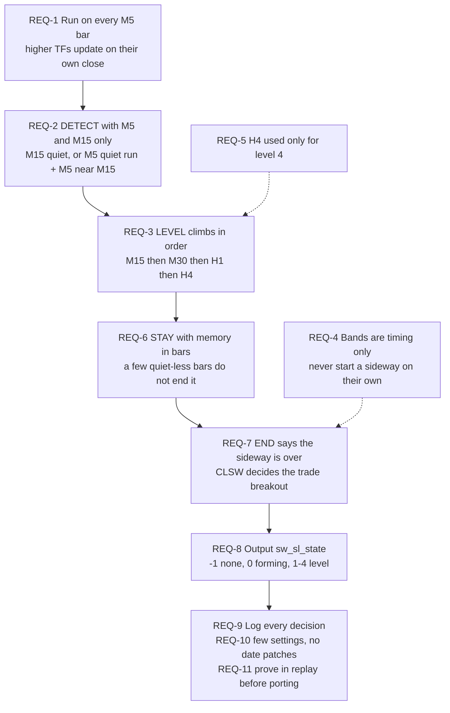
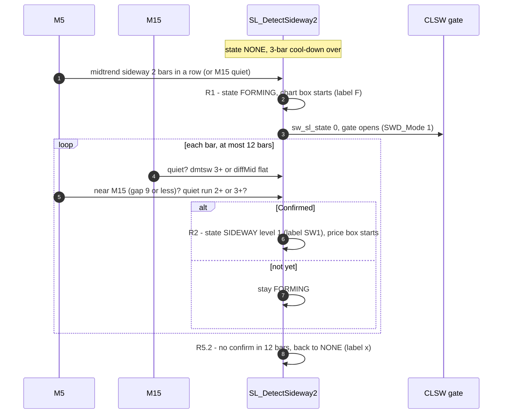
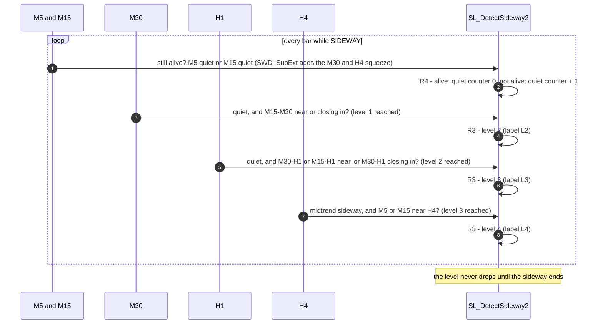
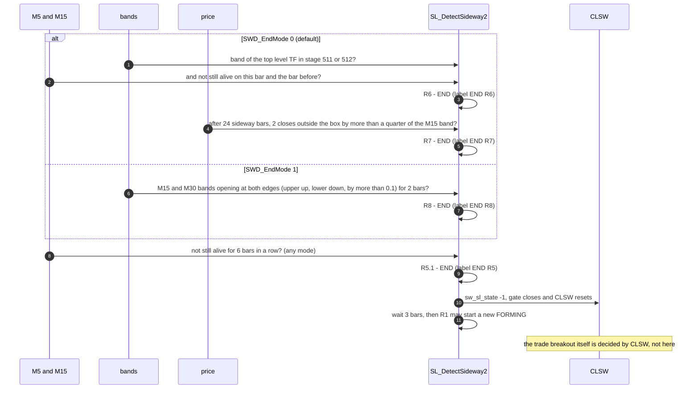
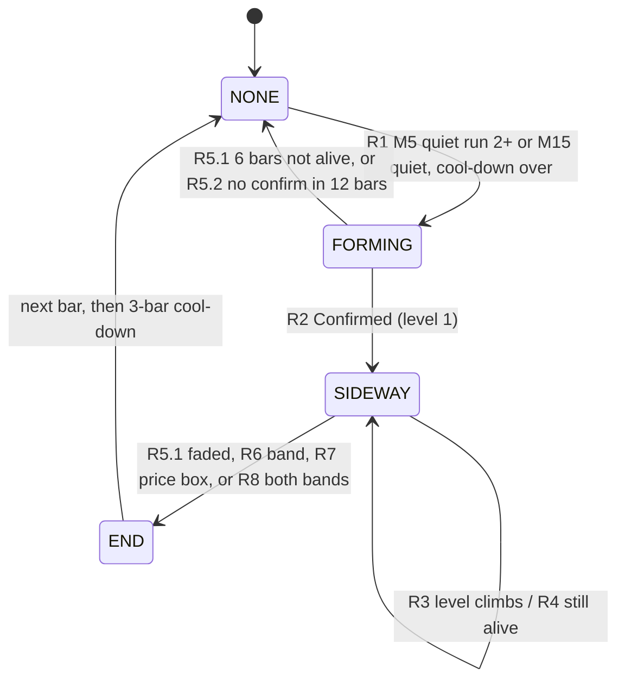
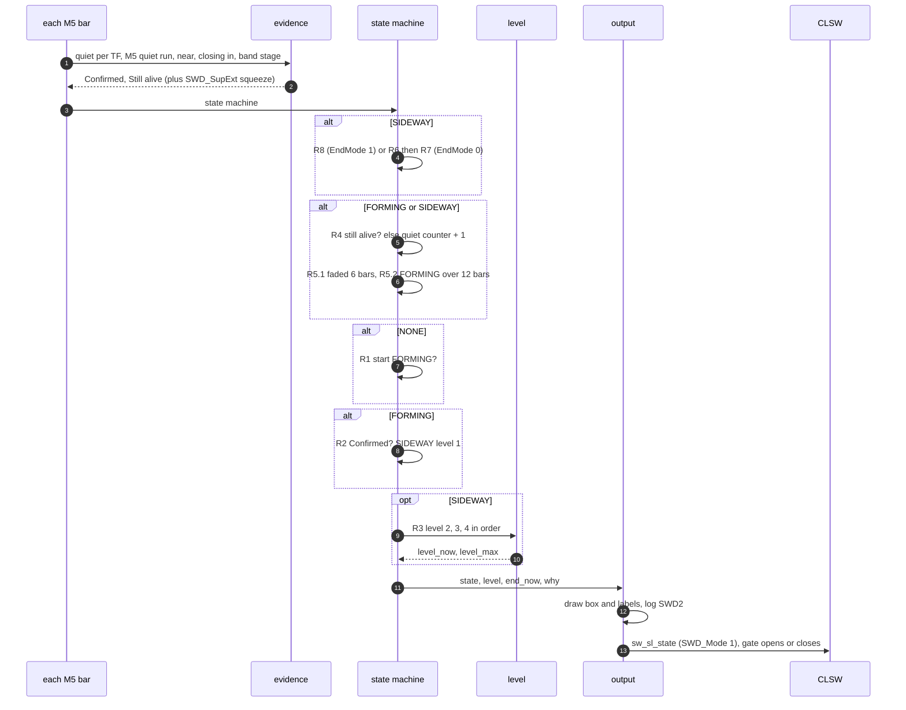

# DetectSideway V2 spec

Nov 5, 2026 · @terry pang

## Purpose

`SL_DetectSideway2` decides on every M5 bar whether price is in a sideway, how high it reaches (level 1–4) and when the sideway is over. It only sets `sw_sl_state`; the real breakout is decided by the CLSW breakout stage. It replaces the tag-matching `SL_DetectSideway` with the same evidence the CLSW code (Ready, strong) already reads, so the gate and Ready can no longer disagree.

|  | `SL_DetectSideway` (now) | `SL_DetectSideway2` (this spec) |
| --- | --- | --- |
| Decides from | about 45 exact tag strings (`SL_Has`) | midtrend, diffMid slope, midline gaps, band stage, price box |
| Rate | M15 bars | M5 bars; higher TFs update on their own bar close |
| Memory | none (resets to −1 every bar) | quiet counter and cool-down in bars; explicit end rules |
| Settings | none tunable, date patches in code | about 15 inputs, each with a meaning |
| Its sideway bars inside your boxes, 2–14 / 15–27 Feb | 75 % / 53 % | 70 % / 59 % (replay) |
| Your sideway bars it catches, 2–14 / 15–27 Feb | 79 % / 85 % | 80 % / 85 % |
| 1 h+ holes inside your boxes | 11 / 6 | 8 / 6 |
| On/off flickers of 20 min or less | 21 / 17 | 1 / 1 |

How a sideway forms on your February charts (19–20 Feb): on each timeframe the **band shrinks**, the **midline goes flat**, and the midline **moves close to the one below**. It happens bottom-up: M5 first, then M15, then M30 and H1. The sideway is over when the **bands widen again**. The detector follows that order, instead of matching the tags it leaves behind.

### Words used in this doc

| Word | What it means | Name in the code |
| --- | --- | --- |
| **Quiet** (a TF) | the TF’s midline has stopped trending: midtrend sideway (dmtsw ≥ 3), or diffMid flat | Settle(k), E1 |
| **M5 quiet run** | how many M5 bars in a row have been midtrend sideway | M5Run, E2 |
| **Near** (two TFs) | their midlines are within the CL\_SW limit, e.g. M5–M15 9 | Join(lo, hi), E3 |
| **Closing in** | their midline gap keeps getting smaller (last 3 different values) | Closing(lo, hi), E4 |
| **Band shrinking / done / expanding** | the band is narrowing / has just stopped narrowing / is in stage 511 or 512 | Shrink, Done, Expand, E5–E7 |
| **Confirmed** | enough evidence to call it a sideway (level 1) | Core |
| **Still alive** | enough evidence on this bar to keep the sideway going | Support |
| **Level** | the highest TF the sideway has reached: 1 M15, 2 M30, 3 H1, 4 H4 | level\_max |
| **Top level TF** | the TF of that level, e.g. H1 for level 3 | hi |
| **Quiet counter** | bars in a row that were not Still alive | quiet |

## Requirements

Eleven requirements; each rule below traces back to one of them.

| # | Requirement | Why (evidence) |
| --- | --- | --- |
| REQ-1 | Run every M5 bar. Higher-TF values change only on their own bar close (same cadence as `SL_CLUpdateGaps`). | The old detector runs on M15 bars, so CLSW reads it up to 10 min late. |
| REQ-2 | **Detect** a sideway with M15 and M5 only: M15 sideway-ish, or M5 sideway several bars in a row with M5 on the M15 midline. | Steadiest factors in both halves of Feb: M15 midtrend sideway ×1.41 / ×1.47, M5 sideway 3+ bars ×1.42 / ×1.37, M15 sideway-ish ×1.39 / ×1.33. |
| REQ-3 | **Level** (1 M15, 2 M30, 3 H1, 4 H4) climbs in order, each TF settling after the one below and joining it. | M30 / H1 factors lose most of their edge in late Feb (×1.41 → ×1.15), so they grade the sideway but never open it. |
| REQ-4 | **Bands are timing only**: shrink, done, expand. A band never opens a sideway on its own. | Band shrinking is on 53–65 % of all bars, lift ×0.92–×1.22. |
| REQ-5 | H4 is used only for level 4. | Every H4 factor flips between the two halves of Feb (×0.61 → ×1.31). |
| REQ-6 | Memory in bars, no clock time: a sideway stays while evidence appears within the last K bars, and ends after K bars with none. | 42 of 117 gate stretches are 20 min or less (flicker); 13 Feb gate dropped 3 times. |
| REQ-7 | The detector only says **when the sideway is over**: the top level’s band in stage 511 / 512 with the lower evidence gone, or the evidence fading. It does not decide the trade breakout or its direction; the CLSW breakout stage does. | Keeps one owner for the breakout. Stage 511 / 512 alone ends sideways early (43 fresh M15 entries inside your 27 boxes). |
| REQ-8 | Output stays compatible: `sw_sl_state` = −1 none, 0 forming, 1–4 sideway level. | The CLSW gate opens on `sw_sl_state ≥ 0` and must keep working unchanged. |
| REQ-9 | Every bar logs which rule fired and the evidence per TF. | Today a miss can only be explained as “the tag didn’t match”. |
| REQ-10 | A small set of settings (about 15 inputs, including display), each with a meaning. No date-specific branches. | The fixed M5–M15 limit of 9 lost a third of its edge from early to late Feb because the bands halved. |
| REQ-11 | Prove it in the Python replay on a split month before porting; keep it switchable with the old detector. | Repo rule: don’t tune rules to fit test data; report real accuracy. |

How the requirements fit together: the first five decide **when** a sideway starts, grows and ends; the rest decide what it outputs and how it is checked. Dashed arrows are limits on a step, not steps.



## Evidence

Seven pieces of evidence, all computed from data the EA already has. TF k runs M5 (0) to H4 (4). Lift = share of the factor’s bars inside your sideways ÷ base rate (56 % on 2–14 Feb, 48 % on 15–27 Feb); ×1.00 means no better than guessing.

| ID | Evidence (plain name) | Exact rule | Source in V3 | Feb lift 2–14 / 15–27 | Used for |
| --- | --- | --- | --- | --- | --- |
| E1 | **Quiet** – Settle(k) | dmtsw\[k\] ≥ 3, **or** diffMid flat: \|d0\| ≤ FLAT\[k\] (0.33, 0.6, 0.7, 0.8, 0.9), or \|d0\| ≤ ½ max(\|d1\|, \|d2\|), or d0 × d1 < 0. A weak midtrend 4/5 counts only through dmtsw (after a 3). | `SL_CLSw`, `SL_CLFlat` | M15 ×1.39 / ×1.33; M5 ×1.28 / ×1.27 | start, confirm, stay (M5, M15); level (M30, H1) |
| E2 | **M5 quiet run** – M5Run | M5 bars in a row with dmtsw\[0\] ≥ 3 | own count | 3+ ×1.42 / ×1.37; 6+ ×1.58 / ×1.41 | start, confirm |
| E3 | **Near** – Join(lo, hi) | 0 ≤ gap(lo, hi) ≤ limit × `SWD_JoinScale`. Limits: M5–M15 9, M15–M30 5, M30–H1 4, M15–H1 2, M5–H4 3.1, M15–H4 1 | `CLSW_TH`, gap read from `BBMidLV` every bar | M5–M15 ×1.44 / ×1.23 | confirm, level |
| E4 | **Closing in** – Closing(lo, hi) | the gap’s last 3 different values each smaller than the one before | `SL_CLGapShrinking` | M5–M15 ×1.22 / ×1.18 | level |
| E5 | **Band shrinking** – Shrink(k) | diffBBW\[k\] < 0, or BBW\_stage 513 / 523 | `BB_diffBBW` | ×0.92–×1.22 | `SWD_SupExt` only |
| E6 | **Band done shrinking** – Done(k) | Shrink(k) on one of the last `SWD_ShrinkMem` bars of TF k, and now neither shrinking nor expanding | planned, not in the `.mqh` yet | not measured | timing for strong (19 Feb 16:40 M30 −3.2 → +1.6) |
| E7 | **Band expanding** – Expand(k) | BBW\_stage\[k\] is 511 or 512 | `BBW_stage` | on 25–42 % of your sideway bars vs 22–48 % of others: no signal alone | End: band (R6) |

Lift = share of the factor’s bars inside your sideways ÷ base rate. ×1.00 means no better than guessing; ×1.40 means 40 % better.

Two derived checks used by the rules:

- **Confirmed** (Core) = M15 quiet **and** (M5 near M15, or M5 quiet run 2+); **or** M5 quiet run ≥ `SWD_RunSide` (3) **and** M5 near M15.
- **Still alive** (Support) = M5 quiet **or** M15 quiet. Two inputs widen it:
  - `SWD_SupJoin` true: M5–M15 near or M15–M30 near also count (worse in the Feb replay, so off).
  - `SWD_SupExt` true: the higher-TF squeeze also counts – M30 quiet; M15–M30 near or closing in; the M30 band shrinking while M15–M30 is closer than 6 bars ago; the H4 band shrinking while M30–H4 is closer than 12 bars ago (your 3 Feb orange and green circles).

## States and outputs

Four states. `sw_sl_state` keeps its meaning for the CLSW gate (open on ≥ 0).

| State | `sw_sl_state` | Meaning |
| --- | --- | --- |
| NONE | −1 | no sideway |
| FORMING | 0 | M5 or M15 has started to settle; the CLSW gate opens |
| SIDEWAY | 1–4 | confirmed; the number is the level (1 M15, 2 M30, 3 H1, 4 H4) |
| END | −1 from the next bar | one-bar event: the sideway is over (R6 expansion or R5 fizzle); `end_now = true`, then NONE and a short cool-down. Not the trade breakout: CLSW decides that |

Outputs, written every M5 bar:

```cpp
struct SWD_struct
{
   int      state;      // SWD_NONE 0, SWD_FORMING 1, SWD_SIDEWAY 2 (END is the bar the state goes back to NONE)
   int      level_now;  // highest level whose rule holds on THIS bar (0 none)
   int      level_max;  // highest level reached since the sideway started (only rises)
   bool     end_now;    // the sideway ended on this bar
   int      end_why;    // 51 faded (R5.1), 52 never confirmed (R5.2), 6 band (R6), 7 price box (R7), 8 both bands (R8)
   datetime start_t;    // bar FORMING began (left edge of the chart box)
   datetime side_t;     // bar SIDEWAY was confirmed
   int      bars;       // bars since start
   int      side_bars;  // bars since SIDEWAY was confirmed (R7 waits SWD_BoxMin of them)
   int      fbars;      // bars spent in FORMING (R5.2)
   int      quiet;      // quiet counter: bars in a row not Still alive (R5.1)
   int      cool;       // bars left before a new FORMING may start
   int      run;        // M5 quiet run
   bool     prev_sup;   // Still alive on the bar before (R6 needs two bars without)
   double   box_lo, box_hi;   // price box of M5 closes since SIDEWAY (R7)
   int      out_n;      // closes in a row outside the box (R7)
   double   draw_lo, draw_hi; // high / low of the whole episode (chart box)
   int      seq;        // episode number (object names)
   string   ev;         // evidence per TF for the log
   string   why;        // rule that decided this bar
};
// sw_sl_state = -1 (NONE or END), 0 (FORMING), level_max (SIDEWAY)
```

## Rules

A sideway goes through three phases: it **forms** (R1, R2), it **continues and climbs** (R3, R4), and it **ends** (R5–R8). Each bar the rules are checked in this order: **end rules first** (R8, or R6 then R7), then **fading** (R4 / R5), then **start / confirm** (R1, R2), then **level** (R3). The first rule that changes the state decides the bar, and `why` records which one.

### Phase 1 – how a sideway forms

M5 goes quiet first (or M15 already is). That opens FORMING and, in mode 1, the CLSW gate. FORMING becomes a SIDEWAY only when M15 is quiet too and M5 sits near the M15 midline (Confirmed). If that doesn’t happen within 12 bars, it was just a pause.



### R1 Enter (NONE → FORMING)

| # | Check | Pass |
| --- | --- | --- |
| 1 | `cool` is 0 (no sideway END in the last `SWD_Cool` bars) | needed |
| 2 | M5Run ≥ `SWD_RunForm` (2) | either 2 or 3 |
| 3 | Settle(M15) | either 2 or 3 |
| → | state = FORMING, `start_t` = now, `level_max` = 0, `quiet` = 0 | log `R1.2` or `R1.3` |

### R2 Confirm (FORMING → SIDEWAY, level 1)

| # | Check | Pass |
| --- | --- | --- |
| 1 | Core(bar): (Settle(M15) and (Join(M5, M15) or M5Run ≥ 2)) or (M5Run ≥ `SWD_RunSide` (3) and Join(M5, M15)) | needed |
| 2 | FORMING has lasted at most `SWD_FormMax` (12) bars | otherwise R5.2 ends it |
| → | state = SIDEWAY, `level_max` = 1 | log `R2.1` |

### Phase 2 – how it continues and climbs

Every bar the sideway must be Still alive (M5 or M15 quiet); a few bars without it are allowed. Meanwhile each higher TF can join in turn: M30 when it goes quiet and comes near M15, H1 after that, H4 last. The level only climbs, one step at a time.



### R3 Level (inside SIDEWAY; climbs in order, `level_max` only rises)

| Level | TF | Check this bar | Also needs |
| --- | --- | --- | --- |
| 1 | M15 | Core(bar) | — |
| 2 | M30 | Settle(M30) **and** (Join(M15, M30) or Closing(M15, M30)) | `level_max` ≥ 1 already |
| 3 | H1 | Settle(H1) **and** (Join(M30, H1) or Join(M15, H1) or Closing(M30, H1)) | `level_max` ≥ 2 already |
| 4 | H4 | dmtsw\[H4\] ≥ 3 **and** (Join(M5, H4) or Join(M15, H4)) | `level_max` ≥ 3 already |

`level_now` = the highest level whose row holds on this bar; `level_max` = the highest ever reached since `start_t`. Several levels can be reached on one bar, as the CLSW ladder does today.

### R4 Stay (FORMING or SIDEWAY keeps going)

| # | Check | Effect |
| --- | --- | --- |
| 1 | Still alive on this bar: M5 quiet or M15 quiet (plus the `SWD_SupJoin` / `SWD_SupExt` extras when on) | quiet counter = 0 |
| 2 | not Still alive on this bar | quiet counter + 1; R5.1 decides when it is too many |

### Phase 3 – how it ends

Four ways, all meaning “the sideway is over”, not “trade now”. The default set is: the lower TFs stop being quiet for 6 bars (R5.1), the top level’s band expands while the lower TFs are not quiet (R6), or price leaves the sideway’s box (R7). Your version (`SWD_EndMode = 1`) replaces R6 and R7 with “M15 and M30 bands both expanding 2 bars” (R8). After any end the detector waits 3 bars before a new FORMING.



### R5 End by fizzle (→ NONE)

| # | Check | Log |
| --- | --- | --- |
| 1 | quiet counter ≥ `SWD_Stay` (6): not Still alive for 6 bars in a row | `R5.1 no Support 6 bars`, label `END R5` |
| 2 | still FORMING after `SWD_FormMax` (12) bars | `R5.2 not confirmed`, label `x` |

### R6 End when the top level’s band expands (default, SWD\_EndMode = 0)

| # | Check | Pass |
| --- | --- | --- |
| 1 | hi = TF of `level_max` (1 M15, 2 M30, 3 H1, 4 H4); BBW\_stage\[hi\] is 511 or 512 | needed |
| 2 | `SWD_EndNeedQuiet` on: no Support on this bar and the bar before (M5 and M15 not sideway-ish, M5–M15 and M15–M30 not joined) | needed (guard) |
| → | `end_now` = true, `end_why` = 6; next bar state = NONE, `cool` = `SWD_Cool` (3) | log `R6 hi expand` |

Why the guard: in February the band is already in 511 / 512 on 25–42 % of your sideway bars, and M15 enters 511 / 512 43 times inside your 27 boxes. With “no Support” added, M15 511 / 512 lands on 64 bars inside your sideways and 556 outside (90 % after the sideway). The end then lags your breakout, which is fine because CLSW owns the breakout.

### R7 End when price leaves its box (default, `SWD_EndMode = 0`)

| # | Check | Pass |
| --- | --- | --- |
| 1 | the sideway has lasted at least `SWD_BoxMin` (24) bars since it was confirmed | needed |
| 2 | the box = lowest and highest M5 close since the sideway was confirmed | — |
| 3 | 2 closes in a row above the box top or below its bottom by more than `SWD_BoxEnd` (0.25) × the M15 band width | needed |
| → | END, `end_why` = 7 | log `R7 price left box`, label `END R7` |

Why: your sideways are price boxes, and the biggest miss was sideways running on into the trend after your box ended (26 Feb). This added about 1 point of precision in the replay.

### R8 End when M15 and M30 bands both expand (your version, `SWD_EndMode = 1`)

| # | Check | Pass |
| --- | --- | --- |
| 1 | M15 band opening at both edges: upper edge rising (`BB_diffUpp[LA]` > `SWD_ExpEdge`, 0.1) **and** lower edge falling (`BB_diffLow[LA]` < −0.1) | needed |
| 2 | M30 band opening at both edges, same test | needed |
| 3 | `SWD_ExpBars` = 2: both checks also hold on the TF bar before (`LA_1`); 1 = this bar only | needed |
| → | END, `end_why` = 8; R6 and R7 are off in this mode, R5.1 still applies | log `R8 M15+M30 band edges opening 2 bars`, label `END R8` |

Why both edges: total band width (diffBBW) also grows when only one edge moves, as price drifts. Both edges moving apart is a real expansion. The same test is already used in `TofySidewayLadder.mqh` for strong expansion.

Why R8: your 3 Feb green circles – the sideway should run until the M15 and M30 bands break out together. With the both-edges test on 2 bars, 3 Feb 13:00 → 4 Feb 01:30 stays **one** sideway in the replay. Across February (15–27 Feb, with `SWD_SupExt` on) it catches 92 % of your sideway bars with 2 holes and no flicker, but only 55 % of its bars are inside your boxes, because it rarely ends a sideway. With `SWD_ExpBars = 1`: 58 % / 91 % / 3 holes / 1 flicker. The 0.1 threshold barely matters; 0.2 and 0.3 gave the same.

Example of the order the rules follow (20 Feb, your pink circle 2): M15 settles and M5 sits on M15 (R1, R2 → level 1), M30 settles at 04:20 with M15–M30 at 2.9 (R3 → level 2), M15–H1 joins at 05:30 with H1 flat (R3 → level 3), then the M15 / M30 / H1 bands expand and the lower evidence fades (R6 ends the sideway; CLSW decides the breakout). The new detector’s actual bars there are not measured yet.

## Sequence each bar

One call per new M5 bar. It reads the evidence, runs the state machine (end rules, fading, start / confirm, level), then draws, logs and writes the output. The first diagram is the whole life of one sideway; the second is what happens inside one bar.

### States



### Calls on one bar



### Functions

| Function in `SL_DetectSideway2.mqh` | What it does |
| --- | --- |
| `SL_DetectSideway2(BB, ctx)` | the detector: once per new M5 bar, evidence → end rules → fading → start / confirm → level → draw, log, write |
| `SWD_Reset()` | clears the state; call in OnInit |
| `SWD_Settle(BB, ctx, k)` | Quiet: `SL_CLSw` (dmtsw ≥ 3) or `SL_CLFlat` (diffMid flat) |
| `SWD_Gap(BB, lo, hi)` / `SWD_Join(BB, lo, hi)` | midline gap from `BBMidLV`; Near = gap within `CLSW_TH` × `SWD_JoinScale` |
| `SWD_Expand(BB, k)` | Band expanding: stage 511 or 512 |
| `SWD_BandW(BB, k)` | band width (2 × upper − mid), for the R7 margin |
| `SWD_SwSlState()` | the output value: −1, 0, or level 1–4 |
| `SWD_DrawBox(now)` / `SWD_DrawLabel(...)` | the chart box and the labels |

Borrowed from the V3 file, so include it after V3: `SL_CLSw`, `SL_CLFlat`, `SL_CLNum`, `SL_CLGapShrinking`, `SL_CLTF`, `CLSW_TH`.

## Settings

The inputs in `SL_DetectSideway2.mqh`. Defaults are the best version from the February replay (settings chosen on 2–14 Feb, checked on 15–27 Feb).

| Input | Default | What it changes | Rule |
| --- | --- | --- | --- |
| `SWD_Enable` | true | run the detector | — |
| `SWD_Mode` | 0 | 0 = draw and log only; 1 = also write `ctx.sw_sl_state[0]`, so the CLSW gate uses it | output |
| `SWD_RunForm` | 2 | M5 quiet-run bars needed to start FORMING | R1 |
| `SWD_RunSide` | 3 | M5 quiet-run bars that, with M5 near M15, confirm without M15 quiet | R2 |
| `SWD_FormMax` | 12 | FORMING bars before giving up | R5.2 |
| `SWD_Stay` | 6 | bars in a row not Still alive before End: faded | R5.1 |
| `SWD_SupJoin` | false | Near (M5–M15, M15–M30) also keeps it alive | R4 |
| `SWD_SupExt` | false | the higher-TF squeeze also keeps it alive | R4 |
| `SWD_EndMode` | 0 | 0 = R6 band + R7 price box; 1 = R8 both bands opening at both edges, set by SWD\_ExpEdge (0.1) and SWD\_ExpBars (2) | R6–R8 |
| `SWD_EndNeedQuiet` | true | R6 also needs the lower TFs not quiet on 2 bars | R6 |
| `SWD_BoxEnd` | 0.25 | R7 margin × M15 band width (below 0 = R7 off) | R7 |
| `SWD_BoxMin` | 24 | sideway bars before R7 is checked | R7 |
| `SWD_Cool` | 3 | bars to wait after an end | R1 |
| `SWD_JoinScale` | 1.0 | multiplies every Near limit | E3 |
| `SWD_Draw`, `SWD_BoxWidth` | true, 6 | chart boxes and labels, border width | chart |
| `SWD_ColForm`, `SWD_ColL1`–`L4` | slate grey, sandy brown, spring green, light coral, khaki | box colour per level (soft tint of that TF’s band colour) | chart |
| `SWD_Log` | true | one `[SWD2]` line per bar while a sideway is on | log |

## Integration and logs

The CLSW code needs no change to use it: it still opens its gate on `ctx.sw_sl_state[0] ≥ 0`.

| Point | What happens |
| --- | --- |
| Include | after `SL_MidCluster_Breakout_V3.mqh` |
| Calls | OnInit: `SWD_Reset();` · OnTick: after `Trade_Strategy(...)`, before `SL_MidCluster_Breakout(...)`: `SL_DetectSideway2(BB_datas, g_tradectx);` |
| `sw_sl_state` | written only with `SWD_Mode = 1`. Your current `SL_DetectSideway` reads `sw_sl_state[1]` as its own history, so keep mode 0 while comparing the two |
| CLSW gate | unchanged (`SL_CLGateOpen`), opens on `sw_sl_state ≥ 0` |
| Settle fix | the “weak 4/5 without a 3” fix lives only in this detector; CLSW’s `SL_CLSideIsh` keeps its clause until tested, because the strong 1/4 needs use it |
| Breakout | decided by the CLSW breakout stage (with `SL_CLGrade()`: −1, S0, S1–S4). The detector only reports that the sideway is over, which closes the gate and resets CLSW |
| Drawing | one box per sideway: solid, width 6, no fill, behind the candles, coloured by level; labels `F`, `SW1`, `L2`–`L4`, `x`, red `END R5`–`R8` |

Log line, one per M5 bar while not NONE:

```
[SWD2] st:SIDEWAY lvl:2/3 bars:41 quiet:0 cool:0 why:R3.L3 ev:{M5:S6J M15:SJ M30:SJ H1:SJ H4:-X} box:4951.20-4968.75 sw_sl:3
```

- `lvl:now/max` = level on this bar / highest level reached.
- `ev` per TF: `S` quiet, the number after M5 = its quiet run, `J` near the TF above, `X` band in 511 / 512, `-` none.
- `why` = the rule that decided the bar (`R1.2 M5 run`, `R2.1 confirm`, `R3.L2`, `R5.1 no Support 6 bars`, `R6 M15 band 511/512`, `R7 price left box`, `R8 M15+M30 bands expanding 2 bars`).
- `box` = the price box used by R7; `sw_sl` = the value written in mode 1.

## Validation

The detector is built in the Python replay first and ported to MQL5 only if it beats the old one on days it was not tuned on.

1. Build R1–R6 in the replay. Every input already exists in the February data.
2. Set `SWD_ExpandMin`, `SWD_Stay`, `SWD_RunForm`, `SWD_JoinScale` on **2–14 Feb only**.
3. Freeze them and score **15–27 Feb**, next to `SL_DetectSideway` on the same days.
4. Run CLSW (Ready, strong, S0) on top of the new gate and score again.
5. If it passes, port to MQL5 behind `SL_SwDetector`. Check MT5 against the replay bar for bar on 3 dates, then run mode 2 (either detector).
6. Confirm on March once it is labelled.

Pass mark on 15–27 Feb:

| Measure | Old detector, 15–27 Feb | New must reach |
| --- | --- | --- |
| Precision (open bars inside your sideways; base 48 %) | 52 % | 60 % or more |
| Recall (your sideway bars covered) | 86 % | 85 % or more |
| Gaps of 1 h+ inside your sideways | 6 | 3 or fewer |
| Open stretches of 20 min or less | to measure | fewer than old |
| Breakouts with a Ready before them (whole month) | 33 / 37 | 33 / 37 or more |
| Ready bars outside your sideways | to measure | no more than old |
| END lag after your sideway box ends (bars), and ENDs inside your boxes | new | reported; ENDs inside boxes fewer than old gate dropouts |

As the repo notes say: report the real numbers, and don’t tune on the test half.

### First replay results

Steps 1–3 are done in the Python replay. The detector holds a sideway steadily and misses less, but it is only a little better at saying “not sideway”, so it does not reach the 60 % pass mark yet.

| On 15–27 Feb (settings chosen on 2–14 Feb) | Old `SL_DetectSideway` | New, defaults | New, your version (`SWD_SupExt` true, `SWD_EndMode` 1) |
| --- | --- | --- | --- |
| Its sideway bars inside your boxes | 53 % | **59 %** | 58 % |
| Your sideway bars it catches | 85 % | 85 % | **87 %** |
| 1 h+ holes inside your boxes | 6 | 6 | **3** |
| On/off flickers of 20 min or less | 17 | **1** | 12 |
| Same first measure on 2–14 Feb | 75 % | 70 % | 64 % |

- **Biggest miss:** sideways that run on into the trend after your box ends (26 Feb 02:00–22:40), because M5 stays quiet and near M15 while M15 / M30 trend. R7 (price box) helps about 1 point.
- **Tried and rejected** (set on 2–14 Feb): staying alive only on dmtsw ≥ 3, and ending when M15 and M30 trend the same way – both dropped recall below 70 %, because your boxes contain bars where M15 and M30 both trend.
- **What is missing:** in these numbers, quiet stretches inside a trend look the same as your sideways. The price rectangles the old detector reads (`r1c`–`r4c`) are the best candidate for the extra check.

## Open items

- [ ] What makes 26 Feb 02:00–22:40 not a sideway to you? It is the detector’s biggest miss.
- [ ] Send a February log with `r0c`–`r4c` per M15 bar, to test the price rectangles as evidence.
- [ ] Confirm which BBW stages mean expanding: 511 / 512 only, or 521 / 522 too (M15 spends 1,515 bars in 521 / 522 in Feb).
- [ ] With `SWD_EndMode = 1`: block a new FORMING right after `END R8` until the M15 band stops expanding, to remove the flicker it brings back (1 → 12).
- [ ] Choose a volatility-scaled Near limit (share of the lower TF’s band, or ATR); the fixed M5–M15 limit lost a third of its edge from early to late Feb.
- [ ] Add Band done shrinking (E6) to the `.mqh` if strong needs it.
- [ ] After testing, decide whether the “weak 4/5 without a 3” fix also goes into CLSW’s `SL_CLSideIsh`.
- [ ] Label March sideways and breakouts, the same way as February, to check the settings on a month they were not tuned on.
